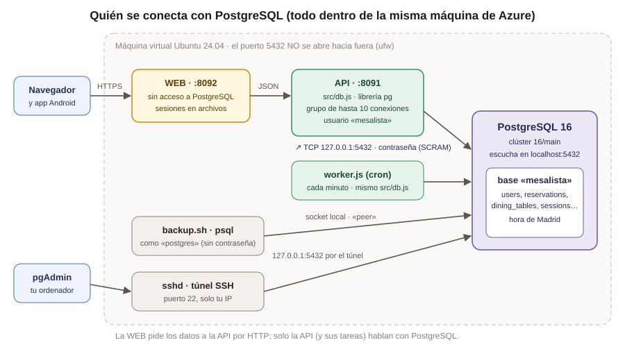
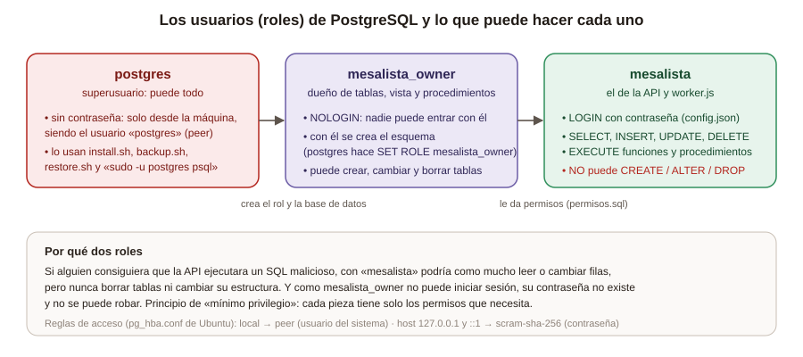
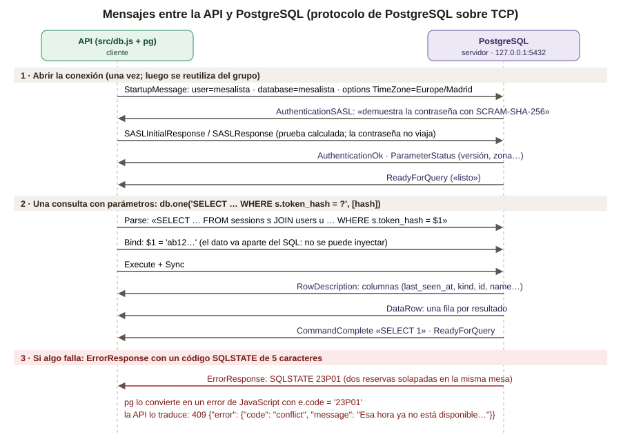
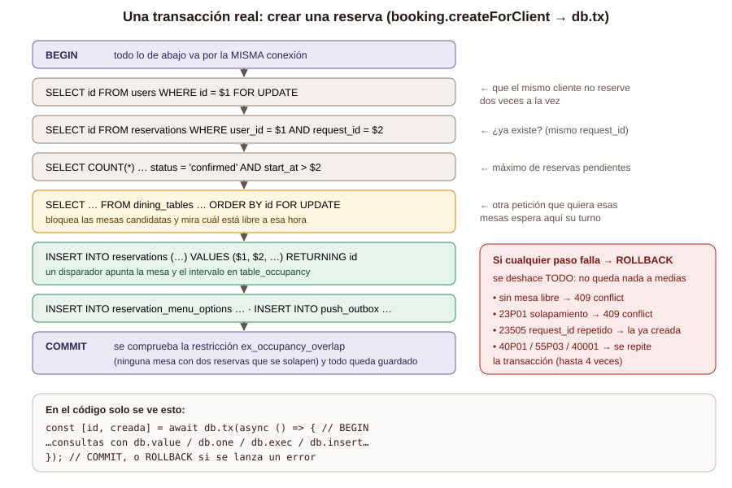

# Manual: cómo se conecta MesaLista con PostgreSQL

Este manual explica cómo llegan los datos desde la web hasta la base de datos
PostgreSQL y de vuelta: qué está configurado y dónde, qué mensajes se
intercambian, cómo son las respuestas y qué pasa cuando algo falla.

Documentos relacionados: [manual-rutas.md](manual-rutas.md) (rutas de la web y de
la API), `docs/integracion.md` y `docs/openapi.yaml` (contrato de la API).

---

## 1. Quién habla con quién



Lo más importante: **la WEB no se conecta a PostgreSQL.** La cadena es siempre:

```
Navegador ──HTTPS──► WEB (:8092) ──HTTP + JSON──► API (:8091) ──protocolo de PostgreSQL──► PostgreSQL (:5432)
```

| Pieza | ¿Habla con PostgreSQL? | Cómo |
|---|---|---|
| **WEB** (`mesalista-web`) | **No** | Pide los datos a la API por HTTP. Sus sesiones se guardan en archivos (`/var/lib/mesalista-web/sesiones`) |
| **API** (`mesalista-api`) | **Sí** | `src/db.js` con la librería `pg`, por TCP a `127.0.0.1:5432`, como usuario `mesalista` |
| **worker.js** (cron, cada minuto) | **Sí** | El mismo `src/db.js` y el mismo usuario que la API |
| **backup.sh**, **restore.sh**, **install.sh** | **Sí** | `psql` y `pg_dump` como usuario `postgres`, por el socket local |
| **App Android** | **No** | Llama a la API, igual que la web |
| **pgAdmin** (tu ordenador) | Sí, para mirar | Por un túnel SSH, nunca directamente |

Por qué así:

- **Un solo sitio con las reglas.** Si la web y la app escribieran directamente en la
  base de datos, cada una tendría que repetir todas las reglas (horas libres,
  mesas, plazos…). Así solo las tiene la API, y la web y la app hacen lo mismo.
- **Menos puertas abiertas.** PostgreSQL solo escucha dentro de la máquina, y
  únicamente la API tiene la contraseña.

---

## 2. Lo que está configurado (lo hizo `install.sh`)

### 2.1 Resumen

| Qué | Dónde | Valor |
|---|---|---|
| Programa | Paquetes `postgresql` y `postgresql-contrib` | PostgreSQL 16 (el de Ubuntu 24.04) |
| Clúster (la instancia que se ejecuta) | `pg_lsclusters` | `16/main` |
| Servicio | `systemctl status postgresql@16-main` | Arranca solo; si se cae, se reinicia |
| Configuración propia | `/etc/postgresql/16/main/conf.d/60-mesalista.conf` | `listen_addresses = 'localhost'`, zona `Europe/Madrid` |
| Quién puede entrar | `/etc/postgresql/16/main/pg_hba.conf` (el de Ubuntu, sin cambios) | Socket local: `peer`. `127.0.0.1` y `::1`: contraseña (`scram-sha-256`) |
| Base de datos | `mesalista` | UTF-8, `C.UTF-8`, dueño `mesalista_owner` |
| Usuarios (roles) | `mesalista_owner`, `mesalista` | Apartado 2.4 |
| Datos de conexión de la API | `/opt/mesalista-servidor/config/config.json`, sección `db` | Apartado 2.5 |
| Extensiones | `btree_gist`, `unaccent` | Para la restricción de solapamientos y la búsqueda sin tildes |
| Cortafuegos | `ufw` | Solo 22, 80 y 443. El **5432 no está abierto** |
| Copias | `/etc/cron.d/mesalista` → `backup.sh` | Cada día a las 03:30, en `/var/backups/mesalista` (14 días) |

### 2.2 El archivo de configuración propio

`install.sh` no toca el `postgresql.conf` original: añade este archivo, que se
carga después.

```ini
# /etc/postgresql/16/main/conf.d/60-mesalista.conf
listen_addresses = 'localhost'     # solo conexiones desde la propia máquina
timezone = 'Europe/Madrid'         # la hora de las fechas
log_timezone = 'Europe/Madrid'     # la hora de los registros
```

`listen_addresses = 'localhost'` es la primera protección: aunque alguien abriera
el puerto 5432 en Azure, PostgreSQL no atendería conexiones de fuera.

### 2.3 Quién puede entrar: `pg_hba.conf`

PostgreSQL decide si acepta una conexión con las reglas de `pg_hba.conf`. Las
de Ubuntu, que se usan tal cual, son:

| Tipo | Base | Usuario | Desde | Método | Significa |
|---|---|---|---|---|---|
| `local` | todas | `postgres` | socket del sistema | `peer` | El usuario del sistema `postgres` entra como `postgres`, sin contraseña |
| `local` | todas | todos | socket del sistema | `peer` | Solo si el usuario del sistema se llama igual que el rol |
| `host` | todas | todos | `127.0.0.1/32` | `scram-sha-256` | Por TCP local, con contraseña |
| `host` | todas | todos | `::1/128` | `scram-sha-256` | Lo mismo por IPv6 local |

- **`peer`**: PostgreSQL pregunta al sistema operativo quién es el usuario que se
  conecta. Por eso `sudo -u postgres psql` entra sin contraseña y un usuario
  normal no puede.
- **`scram-sha-256`**: con contraseña, pero la contraseña **nunca viaja**. El
  cliente demuestra que la conoce con un cálculo (apartado 4.1).

### 2.4 Los usuarios (roles)



Así los crea `install.sh` (la contraseña llega por la entrada estándar, no en la
línea de órdenes, para que no se vea con `ps`):

```sql
CREATE ROLE mesalista_owner NOLOGIN;                -- dueño: nadie puede iniciar sesión con él
CREATE ROLE mesalista LOGIN;                        -- el de la API
ALTER ROLE mesalista LOGIN PASSWORD :'pass';        -- contraseña aleatoria de 48 caracteres
CREATE DATABASE mesalista OWNER mesalista_owner ENCODING 'UTF8' LOCALE 'C.UTF-8' TEMPLATE template0;
```

Y los permisos (`despliegue/permisos.sql`):

```sql
GRANT CONNECT ON DATABASE mesalista TO mesalista;
GRANT USAGE ON SCHEMA public TO mesalista;
REVOKE CREATE ON SCHEMA public FROM PUBLIC;                       -- nadie más crea tablas
GRANT SELECT, INSERT, UPDATE, DELETE ON ALL TABLES IN SCHEMA public TO mesalista;
GRANT USAGE, SELECT ON ALL SEQUENCES IN SCHEMA public TO mesalista;   -- los id automáticos
GRANT EXECUTE ON ALL FUNCTIONS IN SCHEMA public TO mesalista;
GRANT EXECUTE ON ALL PROCEDURES IN SCHEMA public TO mesalista;
ALTER DATABASE mesalista SET timezone TO 'Europe/Madrid';
```

El esquema (`bd/esquema.sql`) se carga como `mesalista_owner`, en **una sola
transacción**: si una línea falla, no queda nada a medias.

```bash
{ echo 'SET ROLE mesalista_owner;'; cat bd/esquema.sql bd/datos.sql; } | sudo -u postgres psql -1 -d mesalista -f -
```

### 2.5 Los datos de conexión de la API

En `/opt/mesalista-servidor/config/config.json`, que solo pueden leer `root` y el
usuario `mesalista`:

```json
"db": {
  "host": "127.0.0.1",
  "port": 5432,
  "name": "mesalista",
  "user": "mesalista",
  "pass": "…48 caracteres hexadecimales…"
}
```

La contraseña la generó `install.sh` (`openssl rand -hex 24`) y no se cambia al
volver a instalar: se lee del `config.json` que ya existe.

---

## 3. Cómo se conecta la API: `src/db.js`

### 3.1 El grupo de conexiones

Abrir una conexión con PostgreSQL cuesta: hay que conectar, autenticarse y
preparar la sesión. Por eso la API abre unas pocas y las **reutiliza**: es un
*pool* (grupo) de conexiones.

```js
pool = new pg.Pool({
  host: c.host,            // 127.0.0.1
  port: c.port,            // 5432
  database: c.name,        // mesalista
  user: c.user,            // mesalista
  password: c.pass,
  max: c.pool ?? 10,       // como mucho 10 conexiones a la vez
  idleTimeoutMillis: 30_000,   // una conexión sin usar 30 s se cierra
  // En cada conexión nueva: hora de Madrid y aislamiento READ COMMITTED.
  options: '-c TimeZone=Europe/Madrid -c default_transaction_isolation=read\\ committed',
});
```

- Una consulta toma una conexión libre del grupo, la usa y la devuelve.
- Si las 10 están ocupadas, la siguiente consulta espera su turno.
- Si PostgreSQL se reinicia, las conexiones rotas se descartan y se abren otras
  (en el registro sale «conexión con PostgreSQL perdida»).

### 3.2 Las funciones que usa el resto del código

Nadie escribe `pool.query` directamente: todo pasa por estas funciones.

| Función | Devuelve | Ejemplo |
|---|---|---|
| `db.all(sql, params)` | Todas las filas (lista) | `db.all('SELECT * FROM menu_options ORDER BY id')` |
| `db.one(sql, params)` | La primera fila, o `null` | `db.one('SELECT * FROM reservations WHERE id = ?', [15])` |
| `db.value(sql, params)` | El primer valor de la primera fila, o `null` | `db.value('SELECT COUNT(*) FROM users')` → `42` |
| `db.exec(sql, params)` | Filas afectadas | `db.exec('DELETE FROM sessions WHERE token_hash = ?', [h])` → `1` |
| `db.insert(sql, params)` | El `id` de la fila nueva | `db.insert('INSERT INTO … VALUES (?, ?)', [a, b])` |
| `db.tx(async () => { … })` | Lo que devuelva la función | Una transacción (apartado 6) |

### 3.3 Los `?`: consultas con parámetros

En el código, los datos **nunca se pegan dentro del texto SQL**. Se escribe un
`?` y el dato va aparte:

```js
await db.one('SELECT * FROM users WHERE email = ?', [email]);
```

`db.js` cambia los `?` por `$1`, `$2`… (lo que entiende PostgreSQL) y la librería
envía el SQL y los datos **en mensajes separados** (apartado 4.2).

Esto impide la **inyección SQL**. Si alguien escribiera como correo
`' OR '1'='1`, con un SQL pegado a mano se colaría en la consulta. Con
parámetros, PostgreSQL lo trata solo como un texto que buscar.

### 3.4 Cómo llegan los tipos de datos a JavaScript

| Tipo en PostgreSQL | En JavaScript | Por qué |
|---|---|---|
| `integer`, `smallint` | `number` | — |
| `bigint` (p. ej. `COUNT(*)`), `numeric` | `number` | `db.js` lo convierte (por defecto `pg` daría texto) |
| `varchar`, `text`, `char` | `string` | — |
| `boolean` | `true` / `false` | — |
| `timestamp` | `string` `"2026-11-28 21:00:00"` | Se deja como texto: las horas son de Madrid y no se convierten a otra zona |
| `date` | `string` `"2026-11-28"` | Ídem |
| `jsonb` | objeto | — |
| `NULL` | `null` | — |

---

## 4. Los mensajes entre la API y PostgreSQL



La API y PostgreSQL hablan con el **protocolo de PostgreSQL**: mensajes
binarios sobre una conexión TCP. No es HTTP ni JSON. La librería `pg` los
construye y los lee: el código de MesaLista no los ve, pero conviene saber qué
pasa.

### 4.1 Abrir la conexión (una vez por conexión del grupo)

| Dirección | Mensaje | Contenido |
|---|---|---|
| API → PG | `StartupMessage` | `user=mesalista`, `database=mesalista`, `options=-c TimeZone=Europe/Madrid …` |
| PG → API | `AuthenticationSASL` | «Demuestra la contraseña con SCRAM-SHA-256» (por la regla `host … scram-sha-256` de `pg_hba.conf`) |
| API → PG | `SASLInitialResponse`, `SASLResponse` | Una prueba calculada a partir de la contraseña. La contraseña no viaja |
| PG → API | `AuthenticationOk`, `ParameterStatus`… | Aceptado, y datos de la sesión (versión, zona horaria, codificación) |
| PG → API | `ReadyForQuery` | Lista para recibir consultas |

Si la contraseña no coincide, PostgreSQL responde `ErrorResponse` con SQLSTATE
`28P01` («password authentication failed») y cierra la conexión.

### 4.2 Una consulta con parámetros

Ejemplo: comprobar el token de una sesión (`src/auth.js`):

```js
const row = await db.one(
  `SELECT s.last_seen_at, s.expires_at, s.kind, u.*
     FROM sessions s JOIN users u ON u.id = s.user_id
    WHERE s.token_hash = ?`,
  [tokenHash],
);
```

| Dirección | Mensaje | Contenido |
|---|---|---|
| API → PG | `Parse` | El SQL con `$1`: `SELECT … WHERE s.token_hash = $1` |
| API → PG | `Bind` | El valor de `$1`: `'ab12…'` (aparte del SQL) |
| API → PG | `Execute`, `Sync` | «Ejecútala» y «fin del grupo de mensajes» |
| PG → API | `RowDescription` | Nombres y tipos de las columnas |
| PG → API | `DataRow` (uno por fila) | Los valores de cada fila |
| PG → API | `CommandComplete` | `SELECT 1` (cuántas filas) |
| PG → API | `ReadyForQuery` | Lista para la siguiente |

`pg` convierte todo eso en un objeto de JavaScript:

```js
{
  rows: [{ last_seen_at: '2026-11-19 12:10:04', expires_at: '2026-11-19 13:00:00', kind: 'app',
           id: 7, name: 'Lucía Pérez', email: 'lucia@mesalista.test', role: 'client', active: true, … }],
  rowCount: 1,
}
```

y `db.one` devuelve `rows[0]`.

### 4.3 Los errores

Si PostgreSQL no puede hacer algo, responde `ErrorResponse` con un código
**SQLSTATE** de 5 caracteres. `pg` lo convierte en un error con `e.code`:

| SQLSTATE | Significa | Qué hace la API |
|---|---|---|
| `23505` | Valor repetido en una columna única (`unique_violation`) | Según el caso: «ese correo ya tiene cuenta» (`409 email_taken`) o devolver la reserva ya creada (`request_id` repetido) |
| `23P01` | Dos filas chocan con una restricción de exclusión | `409 conflict`: «Esa hora ya no está disponible» (dos reservas en la misma mesa) |
| `23503` | Referencia a algo que no existe (`foreign_key_violation`) | Error del programa → `500` |
| `40P01` | Interbloqueo: dos transacciones se esperan la una a la otra | Se repite la transacción (hasta 4 veces) |
| `55P03` | No se ha podido bloquear una fila a tiempo | Se repite la transacción |
| `40001` | Conflicto de serialización | Se repite la transacción |
| `28P01` | Contraseña incorrecta | La API no arranca bien: revisar `db.pass` |
| `57P01` | PostgreSQL se ha parado o reiniciado | La conexión se descarta; la siguiente consulta abre otra |

Un error que no se espera nunca llega tal cual al usuario. La API responde
`500 {"error": {"code": "server_error", …}}` y en el registro solo apunta el
SQLSTATE y el archivo y la línea, nunca los datos (los mensajes de PostgreSQL
pueden incluir valores, como un correo).

---

## 5. De principio a fin: «Mis reservas»

Qué ocurre cuando un cliente abre `/reservas` en el navegador:

1. **Navegador → WEB**: `GET /reservas` con la cookie de sesión de la web.
2. **WEB**: `rutas.js` → `paginas/cliente/reservas.js`, que llama a la API con el
   token guardado en la sesión:

   ```http
   GET /api/v1/reservations
   Authorization: Bearer 9f2c…
   ```

3. **API**, `routes.js` → `auth.client()`. **Primera consulta**: ¿de quién es el token?

   ```sql
   SELECT s.last_seen_at, s.expires_at, s.kind, u.* FROM sessions s JOIN users u ON u.id = s.user_id
    WHERE s.token_hash = $1                -- $1 = SHA-256 del token: el token en claro no se guarda
   ```

   1 fila: Lucía, sesión `app` vigente. Si no hay fila o ha caducado: `401` y fin.

4. **Segunda consulta**: sus reservas, en orden.

   ```sql
   SELECT id FROM reservations WHERE user_id = $1
    ORDER BY status IN ('confirmed','seated') DESC,
             CASE WHEN status IN ('confirmed','seated') THEN start_at END ASC, start_at DESC
   ```

5. **Una consulta por reserva** (`booking.load`) con sus mesas, opciones de menú y
   pago, unida con `JOIN` a `dining_tables`, `reservation_tables`, `payments`…

6. **API**: convierte cada fila en el JSON público (`present.client`). Por ejemplo,
   `start_at = '2026-11-28 21:00:00'` pasa a ser `"date": "2026-11-28", "time": "21:00"`,
   y añade el QR si está confirmada:

   ```json
   {"reservations": [{"id": 15, "status": "confirmed", "date": "2026-11-28", "time": "21:00",
     "party": 4, "table": "S-3", "qr": "ML1.15.1.…", "modifiable": true}]}
   ```

7. **WEB**: reparte las reservas (próximas, solicitudes, anteriores) y dibuja
   `vistas/cliente/reservas.ejs`.
8. **Navegador**: recibe el HTML.

| Tramo | Formato | Puerto |
|---|---|---|
| Navegador ↔ nginx | HTTPS, HTML | 443 |
| nginx ↔ WEB | HTTP, HTML | 127.0.0.1:8092 |
| WEB ↔ API | HTTP, JSON | 127.0.0.1:8091 |
| API ↔ PostgreSQL | Protocolo de PostgreSQL, binario | 127.0.0.1:5432 |

La WEB tiene configurada la API en su `config.json` (`"api": "http://127.0.0.1:8091/api/v1"`,
lo escribe `instalar.sh`), así que llama a la API por dentro de la máquina, sin
pasar por nginx. Le envía `X-Forwarded-Proto: https` y la IP del navegador, que
la API solo acepta porque la petición llega de `127.0.0.1`.

---

## 6. Transacciones y bloqueos

### 6.1 Qué es una transacción

Un grupo de cambios que se hacen **todos o ninguno**. Si al crear una reserva
se guarda la reserva pero falla al guardar su menú, no puede quedar una reserva
sin menú: se deshace todo.

```sql
BEGIN;          -- empieza
  …cambios…
COMMIT;         -- guarda todo      (o ROLLBACK: deshace todo)
```

En MesaLista se escribe así:

```js
const id = await db.tx(async () => {
  // todas las consultas de aquí dentro van por la misma conexión y la misma transacción
  const nueva = await db.insert('INSERT INTO reservations (…) VALUES (…)', […]);
  await db.exec('INSERT INTO reservation_menu_options (…) VALUES (…)', […]);
  return nueva;
});   // COMMIT si todo ha ido bien; ROLLBACK si dentro se ha lanzado un error (también un fail(409…))
```

### 6.2 Ejemplo real: crear una reserva



El problema que resuelve: **dos personas pulsan «Confirmar» a la vez para la
última mesa libre**. Sin cuidado, las dos verían la mesa libre y las dos la
reservarían.

1. **`SELECT … FOR UPDATE`** sobre las mesas candidatas: las **bloquea**. La
   segunda transacción que quiera esas mesas **espera** a que la primera termine.
2. La primera elige la mesa, inserta la reserva y hace `COMMIT`.
3. La segunda continúa, ve que la mesa ya está ocupada a esa hora y elige otra.
   Si no queda ninguna, responde `409 conflict`.
4. Segunda protección: la tabla `table_occupancy` tiene una **restricción de
   exclusión**: dos filas de la misma mesa no pueden tener intervalos que se solapen.

   ```sql
   CONSTRAINT ex_occupancy_overlap EXCLUDE USING gist (table_id WITH =, period WITH &&)
     DEFERRABLE INITIALLY DEFERRED      -- se comprueba al hacer COMMIT
   ```

   Aunque el programa tuviera un fallo, PostgreSQL rechazaría la segunda reserva
   con `23P01`.

### 6.3 Nivel de aislamiento

Todas las conexiones usan **READ COMMITTED** (`options` del grupo): cada
consulta ve lo que otras transacciones **ya han confirmado**. Junto con los
bloqueos `FOR UPDATE`, garantiza que la comprobación de solapamientos ve las
reservas recién creadas.

### 6.4 Lo que se hace después del COMMIT

Los correos y los avisos push se guardan **dentro** de la transacción, en las
tablas `email_outbox` y `push_outbox`, y se envían **después** de responder.
Así, si la transacción se deshace, no se envía un aviso de una reserva que no
existe. Lo que no se pueda enviar lo reintenta `worker.js` cada minuto.

---

## 7. El esquema: qué hay en la base de datos

`bd/esquema.sql` crea todo. Las tablas, por temas:

| Tema | Tablas |
|---|---|
| Cuentas y acceso | `users` (contraseña con argon2), `sessions` (solo el hash del token), `login_attempts`, `link_attempts`, `password_resets` |
| Mesas y horario | `dining_tables` (con posición en el plano), `service_slots` (franjas), `closed_days`, `table_holds` (bloqueos), vista `table_blocks` |
| Reservas | `reservations`, `reservation_tables` (mesas unidas), `table_occupancy` (para la restricción de solapamientos), `reservation_menu_options`, `menu_options` |
| Grupos y pagos | `group_requests`, `payments` |
| Avisos | `notifications` (avisos en la app y la web), `push_devices`, `push_outbox`, `email_outbox` |
| Ajustes | `settings` (parámetros del restaurante), `secrets` (PIN de «Cerrar local», con argon2) |

Además:

| Objeto | Qué hace |
|---|---|
| Disparadores `*_updated` | Ponen `updated_at` al día en cada cambio (el panel lo usa para saber cuándo recargar) |
| Disparadores `*_occupancy` | Mantienen `table_occupancy` al crear, mover o cancelar reservas |
| Función `search_key(text)` | Quita tildes y mayúsculas para buscar por nombre (`unaccent`) |
| Procedimiento `sp_mark_no_shows(ahora)` | Marca las no presentadas, libera las señales sin pagar y caduca sus solicitudes. Lo llama `worker.js` cada minuto |
| Procedimiento `sp_daily_purge(hoy)` | Borra los datos personales caducados (protección de datos). A las 04:00 |

`bd/datos.sql` añade los parámetros y las opciones de menú, y `bd/restaurante.sql`
el local preconfigurado (14 mesas, plano y franjas). Este último solo si todavía
no hay mesas.

---

## 8. Tareas automáticas y copias

| Cuándo | Qué | Usuario de PostgreSQL |
|---|---|---|
| Cada minuto | `worker.js`: `CALL sp_mark_no_shows(…)`, devoluciones, correos, push | `mesalista` (contraseña de `config.json`) |
| 04:00 | `worker.js --diario`: `CALL sp_daily_purge(…)` | `mesalista` |
| 03:30 | `backup.sh`: `pg_dump --format=custom mesalista` + `config.json` → `.tar.gz` | `postgres` (peer) |

- **La copia** se hace sin parar el servicio. `pg_dump` lee todo dentro de una
  transacción, así que la copia es coherente aunque haya reservas entrando.
- **Restaurar** (`sudo bash /usr/local/lib/mesalista/restore.sh <copia.tar.gz>`):
  borra la base de datos, la vuelve a crear, carga la copia con
  `pg_restore --role=mesalista_owner`, pone la contraseña y aplica `permisos.sql`.

---

## 9. Mirar la base de datos

### 9.1 Con `psql` en la máquina

```bash
sudo -u postgres psql -d mesalista
```

| Orden | Para qué |
|---|---|
| `\dt` | Lista las tablas |
| `\d reservations` | Columnas, índices y restricciones de una tabla |
| `\du` | Los roles y sus atributos |
| `\x` | Muestra cada fila en vertical (más legible) |
| `\q` | Salir |

Consultas útiles (terminan en `;`):

```sql
-- Reservas de hoy con su mesa
SELECT r.id, r.start_at, r.party_size, r.status, t.zone, t.number
  FROM reservations r JOIN dining_tables t ON t.id = r.table_id
 WHERE r.start_at::date = CURRENT_DATE ORDER BY r.start_at;

-- Cuántas reservas hay en cada estado
SELECT status, COUNT(*) FROM reservations GROUP BY status;

-- Conexiones abiertas ahora (la API suele tener entre 1 y 10)
SELECT usename, application_name, client_addr, state FROM pg_stat_activity WHERE datname = 'mesalista';
```

**Cuidado:** como `postgres` puedes cambiar o borrar cualquier cosa. Para solo
mirar, no escribas `UPDATE`, `DELETE`, `DROP` ni `TRUNCATE`.

### 9.2 Con pgAdmin desde tu ordenador

Por un túnel SSH (pestaña *SSH Tunnel* de pgAdmin): túnel a `azureuser@<dominio>`
con tu clave `.pem`, y dentro `127.0.0.1:5432`, base `mesalista`, usuario
`mesalista` y la contraseña de `db.pass`:

```bash
sudo node -e "console.log(require('/opt/mesalista-servidor/config/config.json').db.pass)"
```

### 9.3 Comprobar que todo está bien

```bash
sudo mesalista estado        # incluye «base de datos: N mesas activas»
pg_lsclusters                # 16 main 5432 online postgres …
pg_isready                   # /var/run/postgresql:5432 - accepting connections
sudo journalctl -u postgresql@16-main -n 50
sudo tail -n 50 /var/log/postgresql/postgresql-16-main.log
```

---

## 10. Seguridad, en resumen

| Medida | Dónde |
|---|---|
| PostgreSQL solo escucha en la propia máquina | `listen_addresses = 'localhost'` y el puerto 5432 cerrado en `ufw` |
| Solo la API tiene contraseña para la base de datos | `config.json` (permisos `640`, `root:mesalista`) |
| La API no puede cambiar la estructura | Rol `mesalista` sin `CREATE`, `ALTER` ni `DROP` |
| La contraseña no viaja | SCRAM-SHA-256 |
| No hay inyección SQL | Consultas con parámetros (`?` → `$1`) |
| Datos sensibles con hash | Contraseñas y PIN de «Cerrar local» con argon2; tokens de sesión con SHA-256 |
| Nada queda a medias | Transacciones (`db.tx`) |
| Copias protegidas | `/var/backups/mesalista` con permisos `700` (solo `root`) |

---

## 11. Problemas frecuentes

| Síntoma | Causa probable | Qué hacer |
|---|---|---|
| `sudo mesalista estado`: «no se puede consultar la base de datos» | PostgreSQL parado | `pg_lsclusters`; `sudo systemctl start postgresql@16-main` |
| En `sudo mesalista logs`: «password authentication failed» (`28P01`) | `db.pass` no coincide con la del rol | Vuelve a ejecutar `install.sh`: lee `db.pass` y vuelve a poner esa contraseña al rol |
| «connection refused» (`ECONNREFUSED 127.0.0.1:5432`) | PostgreSQL no escucha | `pg_isready`; revisa `60-mesalista.conf` y el registro de PostgreSQL |
| `permission denied for table …` | Tabla nueva sin permisos para `mesalista` | `sudo -u postgres psql -d mesalista -f /usr/local/lib/mesalista/permisos.sql` |
| La web dice «No se puede conectar con el servidor de reservas» | La API está parada (no es PostgreSQL) | `systemctl status mesalista-api` |
| pgAdmin no conecta | Túnel SSH o contraseña | Ver 9.2. El puerto 5432 no se abre nunca hacia fuera |
| Hay que empezar de cero | — | `sudo bash despliegue/install.sh --reset-db` (borra todo; pide escribir BORRAR) |

---

## 12. Glosario

| Término | Qué es |
|---|---|
| **PostgreSQL** | El programa de base de datos donde se guardan reservas, cuentas, mesas… |
| **Clúster** | Una instancia de PostgreSQL en marcha (aquí `16/main`), con sus bases de datos |
| **Base de datos** | Conjunto de tablas de un proyecto (`mesalista`) |
| **Tabla / fila / columna** | Como una hoja de cálculo: cada fila es un registro y cada columna un dato |
| **Esquema** | La definición de las tablas y sus reglas (`bd/esquema.sql`); también el espacio `public` donde están |
| **Rol** | Usuario de PostgreSQL. Puede poder iniciar sesión (`LOGIN`) o no (`NOLOGIN`) |
| **Permiso (GRANT)** | Lo que un rol puede hacer sobre un objeto (leer, escribir, ejecutar) |
| **SQL** | El lenguaje para pedir y cambiar datos: `SELECT`, `INSERT`, `UPDATE`, `DELETE` |
| **Consulta con parámetros** | SQL con huecos (`$1`) cuyos valores se envían aparte |
| **Inyección SQL** | Ataque que mete SQL dentro de un dato; los parámetros lo impiden |
| **Pool (grupo de conexiones)** | Conexiones abiertas que se reutilizan en lugar de abrir una por consulta |
| **Socket local** | Conexión dentro de la máquina, sin red (la usa `sudo -u postgres psql`) |
| **peer** | Método de acceso: PostgreSQL cree al sistema operativo sobre quién eres |
| **SCRAM-SHA-256** | Método de contraseña en el que la contraseña nunca viaja por la conexión |
| **Transacción** | Grupo de cambios que se aplican todos o ninguno (`BEGIN` … `COMMIT` / `ROLLBACK`) |
| **Bloqueo (FOR UPDATE)** | Reserva una fila para que otra transacción espere antes de tocarla |
| **Restricción** | Regla que PostgreSQL hace cumplir siempre (única, de exclusión, clave ajena…) |
| **SQLSTATE** | Código de 5 caracteres que identifica un error de PostgreSQL |
| **Disparador (trigger)** | Código que PostgreSQL ejecuta solo al cambiar una tabla |
| **Procedimiento** | Código guardado en la base de datos que se ejecuta con `CALL` |
| **pg_dump / pg_restore** | Programas para hacer y recuperar copias de una base de datos |
| **pg_hba.conf** | Archivo que decide quién puede conectarse, desde dónde y cómo |
