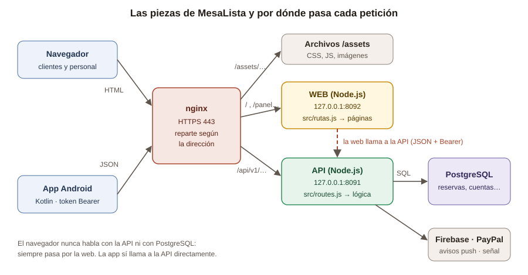
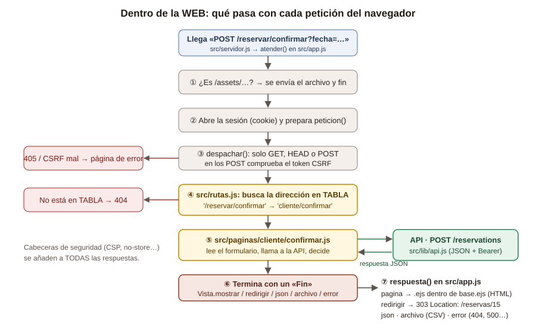
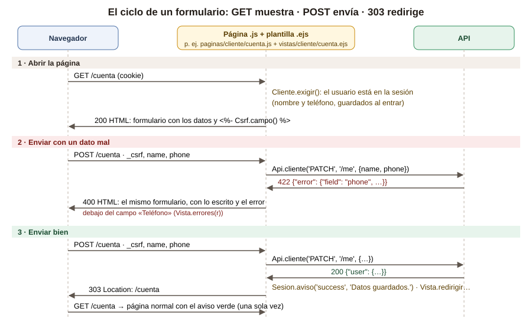

# Manual: programar la web de MesaLista (Node.js, plantillas EJS y Bootstrap)

Este manual explica cómo está hecha la web y cómo programarla: qué hace cada
archivo `.js` y cada plantilla `.ejs`, cómo viajan las peticiones y las
respuestas a través de ellos, y cómo se añade o se cambia una página.

Documentos relacionados:

- [manual-rutas.md](manual-rutas.md): las rutas de la web y de la API, con diagramas del flujo.
- [paginas.md](paginas.md): qué archivo corresponde a cada página.
- [manual-estilo.md](manual-estilo.md): colores, letra, distribución y textos.
- [manual-base-de-datos.md](manual-base-de-datos.md): la API y PostgreSQL.
- [instalacion.md](instalacion.md): instalar la web en Azure.

---

## 1. Qué hace la web y qué no



| La web **sí** | La web **no** |
|---|---|
| Recibe las peticiones del navegador (a través de nginx) | No tiene base de datos ni se conecta a PostgreSQL |
| Muestra páginas HTML con Bootstrap | No decide reglas (horas libres, mesas, plazos) |
| Guarda la sesión de cada persona (en archivos) | No guarda reservas ni cuentas |
| Pide los datos y las acciones a la API, con el token de la sesión | El navegador nunca habla con la API ni ve su token |

**Regla de oro:** la web pregunta a la API y muestra lo que responde. Si la API
dice que una hora no está libre, la web no lo discute: muestra el mensaje.

---

## 2. Herramientas y primera puesta en marcha

| Herramienta | Para qué |
|---|---|
| **Node.js 20.11 o posterior** (con `npm`) | Ejecutar la web |
| **Visual Studio Code** (u otro editor) | Editar los `.js` y `.ejs`. La extensión «EJS language support» colorea las plantillas |
| **Git** | Bajar y subir el código |
| **Navegador con F12** | Ver la página, la consola y las peticiones |

```bash
git clone https://github.com/LXPT-UIB/WEB.git
cd WEB
npm install                                        # instala ejs (la única dependencia)
copy config\config.example.json config\config.json # en Linux/Mac: cp …
npm start                                          # http://127.0.0.1:8092
```

En `config/config.json` de tu ordenador:

```json
{
  "listen": { "host": "127.0.0.1", "port": 8092 },
  "api": "https://mesalista.spaincentral.cloudapp.azure.com/api/v1",
  "https": false,
  "sesiones": { "carpeta": "sesiones", "minutos": 120 }
}
```

| Clave | Qué es |
|---|---|
| `listen` | Dirección y puerto en que escucha la web |
| `api` | Dirección de la API. La de Azure, o `http://127.0.0.1:8091/api/v1` si tienes el Servidor en tu ordenador |
| `https` | `false` en tu ordenador (vas por `http://`). Con `true`, la cookie lleva `Secure` y sin HTTPS no se guarda la sesión |
| `sesiones` | Carpeta de las sesiones y minutos sin uso hasta que caducan |

En Windows, si PowerShell dice que «la ejecución de scripts está deshabilitada»,
usa `npm.cmd start` o abre **cmd**.

Cuándo hay que reiniciar (`Ctrl+C` y `npm start`):

| Cambias… | ¿Reiniciar? |
|---|---|
| Una plantilla `vistas/*.ejs` | No: recarga el navegador |
| CSS, JS o imágenes de `publico/assets/` | No: recarga (Ctrl+F5 si no ves el cambio) |
| Un `.js` de `src/` | **Sí** |
| `config/config.json` | **Sí** |

---

## 3. Estructura del proyecto

```
WEB/
├── package.json             nombre, versión, «npm start» y la dependencia (ejs)
├── config/
│   ├── config.example.json  modelo de configuración (se sube a Git)
│   └── config.json          la configuración de cada instalación (NO se sube)
├── bin/escribir-config.js   crea config.json al instalar en el servidor
├── src/                     el programa (se ejecuta en el servidor)
│   ├── servidor.js          arranca el servidor HTTP
│   ├── app.js               atiende cada petición: seguridad, sesión, CSRF, página, respuesta
│   ├── rutas.js             dirección → página
│   ├── config.js            lee config.json
│   ├── lib/                 piezas que usan todas las páginas
│   │   ├── peticion.js      datos de la petición actual y lectura de formularios
│   │   ├── sesion.js        sesiones (archivos), usuario, avisos de un solo uso
│   │   ├── csrf.js          token contra formularios falsos
│   │   ├── api.js           llamadas a la API
│   │   ├── vista.js         cómo termina una página (mostrar, redirigir…) y campos de formulario
│   │   ├── html.js          escapar texto, construir direcciones, versionar archivos
│   │   ├── formato.js       fechas, estados y cantidades en español
│   │   └── zonas.js         ayudas de la zona de clientes, del panel y de administración
│   └── paginas/             UNA página por archivo: publico/, cliente/, panel/, admin/
├── vistas/                  las plantillas EJS (HTML con huecos)
│   ├── base.ejs             esqueleto común: <head>, menú, avisos, pie
│   ├── menu-cliente.ejs, menu-panel.ejs, error.ejs
│   └── publico/, cliente/, panel/, admin/   una plantilla por página (y trozos _x.ejs)
├── publico/assets/          lo que se descarga el navegador tal cual
│   ├── css/                 mesalista.css, panel.css
│   ├── js/                  mesalista.js, panel.js, tema.js (se ejecutan en el navegador)
│   ├── bootstrap/, vendor/  Bootstrap 5.3.8 y librerías (jsQR, qrcode-generator)
│   └── icono.svg
├── despliegue/              instalar.sh, nginx-mesalista.conf, mesalista-web.service
└── docs/                    los manuales
```

Hay **dos tipos de JavaScript**, y no hay que confundirlos:

| | `src/**/*.js` | `publico/assets/js/*.js` |
|---|---|---|
| **Dónde se ejecuta** | En el servidor (Node.js) | En el navegador de cada persona |
| **Qué puede hacer** | Leer archivos, llamar a la API, guardar la sesión | Tocar la página: botones, cuentas atrás, QR |
| **Quién lo ve** | Nadie | Cualquiera (F12) |
| **Secretos** | Puede manejar el token de la API | **Nunca**: no puede tener tokens ni claves |

---

## 4. Lo justo de JavaScript (Node.js) para leer el código

```js
// Módulos: cada archivo importa lo que usa y exporta lo que ofrece.
import { Vista } from '../../lib/vista.js';
export default async function () { … }          // la función principal de una página

// Constantes y variables
const ruta = '/reservas';                        // no cambia
let errores = {};                                // puede cambiar

// Objetos y listas
const datos = { name: 'Lucía', phone: '600123123' };
datos.name;                                      // 'Lucía'
const horas = ['13:00', '13:30'];
horas.length;                                    // 2

// Funciones flecha y texto con huecos
const saludo = (n) => `Hola, ${n}`;              // saludo('Lucía') → 'Hola, Lucía'

// async / await: esperar a algo lento (la API) sin bloquear el servidor
const r = await Api.cliente('GET', '/reservations');

// Desestructurar: sacar varias claves de un objeto de una vez
const { get, post, metodo } = peticion();

// ?? y ?.: valor por defecto y acceso seguro
const next = get.next ?? '/';                    // si get.next no existe, '/'
const id = r.body.reservation?.id;               // undefined si reservation no existe
```

El servidor atiende a mucha gente a la vez. `await` no lo para: mientras una
petición espera a la API, atiende otras.

---

## 5. Cómo viaja una petición por la web



En resumen (el detalle está en [manual-rutas.md](manual-rutas.md)):

1. `servidor.js` recibe la petición y llama a `atender()` de `app.js`.
2. Si es `/assets/…`, devuelve el archivo (en Azure lo hace nginx antes).
3. Abre la **sesión** (cookie `mlweb`) y prepara `peticion()`.
4. Solo admite GET, HEAD y POST. En los **POST** lee el formulario y comprueba el **token CSRF**.
5. Busca la dirección en `rutas.js` y ejecuta la **página** (`src/paginas/…js`).
6. La página llama a la **API**, si hace falta, y termina con un **«Fin»**.
7. `app.js` convierte el Fin en la respuesta: HTML (plantilla `.ejs` dentro de
   `base.ejs`), redirección, JSON, archivo o página de error. Añade las cabeceras
   de seguridad y guarda la sesión.

---

## 6. Las páginas `.js`

### 6.1 Forma de una página

Cada archivo de `src/paginas/` exporta **una función**. La web la llama con los
números de la dirección (`/reservas/15` → `p.id = 15`):

```js
// src/paginas/cliente/reserva.js (simplificada)
import { Vista } from '../../lib/vista.js';
import { Api } from '../../lib/api.js';
import { Cliente } from '../../lib/zonas.js';

export default async function (p) {
  Cliente.exigir();                                                    // 1. ¿tiene sesión?
  const { reservation } = (await Api.cliente('GET', `/reservations/${p.id}`)).datos();   // 2. datos
  Vista.mostrar('cliente/reserva', { r: reservation }, { titulo: 'Reserva', activa: 'reservas' });  // 3. fin
}
```

Una página **siempre termina** llamando a una función de `Vista` (o una que
termina por ella, como `Cliente.exigir()` sin sesión). Si se olvida, la web
registra el error «La página … no ha terminado con una respuesta» y muestra un
error 500.

### 6.2 Lo que llega: `peticion()`

```js
import { peticion, texto, entero, enteroValido, lista } from '../../lib/peticion.js';
const ctx = peticion();
```

| Campo | Qué es | Ejemplo |
|---|---|---|
| `ctx.metodo` | `'GET'`, `'HEAD'` o `'POST'` | `if (ctx.metodo === 'POST') { … }` |
| `ctx.ruta` | La dirección, sin la consulta | `'/reservar/confirmar'` |
| `ctx.uri` | La dirección con la consulta (para volver) | `'/reservar/confirmar?fecha=…'` |
| `ctx.get` | La consulta `?a=1&b=2` | `ctx.get.fecha` → `'2026-11-28'` |
| `ctx.post` | El formulario enviado (en POST) | `ctx.post.email` |
| `ctx.ip` | IP del navegador (la pasa nginx) | Para que la API bloquee por persona |

Los valores del formulario llegan **siempre como texto** y pueden faltar o venir
manipulados. Por eso se leen con ayudas que nunca fallan:

| Ayuda | Devuelve | Ejemplo |
|---|---|---|
| `texto(v)` | El texto, o `''` si falta o no es texto | `texto(post.name).trim()` |
| `entero(v)` | Número entero, o `0` | `entero(post.party)` |
| `enteroValido(v)` | Número si es un entero limpio, o `null` | `enteroValido(get.personas)` |
| `lista(v)` | Lista de los valores de `nombre[]` | `lista(post['menu_options'])` |

### 6.3 Cómo termina: `Vista`

| Llamada | Respuesta |
|---|---|
| `Vista.mostrar('cliente/cuenta', datos, opciones, status = 200)` | HTML: `vistas/cliente/cuenta.ejs` dentro de `base.ejs` |
| `Vista.redirigir('/reservas/15')` | `303 Location: /reservas/15` |
| `Vista.json(200, { … })` | JSON (para el JavaScript de la propia web) |
| `Vista.archivo('text/csv; charset=utf-8', 'agenda.csv', texto)` | Descarga |
| `Vista.error(403, 'Título', 'Texto')` | Página de error con ese código |
| `Vista.noEncontrada()` | Página 404 |

**Opciones de `Vista.mostrar`:**

| Opción | Qué hace | Valores |
|---|---|---|
| `titulo` | Título de la pestaña («… · MesaLista») | Texto |
| `zona` | Menú de clientes o del panel | `'cliente'` (por defecto) o `'panel'` |
| `ancho` | Ancho de la página | `'estrecho'`, sin poner (normal) o `'ancho'` |
| `activa` | Opción del menú que sale marcada | `'reservas'`, `'cuenta'`… |
| `scripts` | Otros JS para esta página | `['/assets/vendor/jsQR-1.4.0.js']` |
| `recargar` | Panel: la página se recarga sola si cambian los datos | `true` |

En el panel se usa el atajo `Panel.mostrar(plantilla, datos, titulo, activa)`,
que ya pone `zona: 'panel'` y `ancho: 'ancho'`.

### 6.4 Quién es: `Sesion` y las zonas

```js
import { Sesion } from '../../lib/sesion.js';
import { Cliente, Panel, Admin } from '../../lib/zonas.js';
```

| Llamada | Para qué |
|---|---|
| `Cliente.exigir()` | Devuelve el usuario cliente; sin sesión, lleva a `/entrar` (y vuelve después) |
| `Panel.exigir()` / `Panel.exigirAdmin()` | Lo mismo para el personal / solo administración |
| `Sesion.usuario('cliente')` | El usuario (`{ id, name, email, phone }`) o `null`, sin redirigir |
| `Sesion.entrar('cliente', session, user)` | Guarda el token y el usuario tras `/auth/login` (cambia el id de la sesión) |
| `Sesion.aviso('success', 'Datos guardados.')` | Mensaje para **la página siguiente** (`success`, `info`, `warning`, `danger` o `alerta`) |
| `Sesion.leer(clave)` / `poner(clave, valor)` / `quitar(clave)` | Guardar algo propio en la sesión |

### 6.5 Hablar con la API: `Api`

```js
import { Api } from '../../lib/api.js';
const r = await Api.cliente('PATCH', '/me', { name, phone });
```

| Llamada | Sesión | Si la API responde 401 |
|---|---|---|
| `Api.cliente(método, ruta, cuerpo)` | Del cliente | Aviso y a `/entrar` |
| `Api.panel(método, ruta, cuerpo)` | Del personal | Aviso y a `/panel/entrar` |
| `Api.call(zona, método, ruta, cuerpo)` | La de la zona, si hay | Devuelve el 401 (para entrar o registrarse) |
| `Api.config()` | — | `GET /config`, una vez por petición |

La respuesta `r`:

| | Da |
|---|---|
| `r.ok()` | `true` si fue 2xx |
| `r.body` | El JSON de la API |
| `r.datos()` | El JSON si fue bien; si no, termina con una página de error |
| `r.code()`, `r.message()`, `r.field()` | Código, mensaje (en español) y campo del error |
| `r.status` | El código HTTP; `0` si no hay conexión con la API |

Para direcciones con consulta, `url()` construye la dirección y escapa los valores:

```js
import { url } from '../../lib/html.js';
await Api.cliente('GET', url('/availability', { date: fecha, party: personas }));
// → /availability?date=2026-11-28&party=4
```

La lista de todas las rutas de la API está en [manual-rutas.md](manual-rutas.md),
apartado 6, y en `docs/openapi.yaml` del repositorio Servidor.

---

## 7. Las plantillas `.ejs`

### 7.1 Qué es EJS

Una plantilla EJS es **HTML con huecos**. El servidor la rellena con los datos
que le pasa la página y envía el HTML terminado. El navegador nunca ve los `<% %>`.

| Etiqueta | Qué hace | Ejemplo |
|---|---|---|
| `<%= x %>` | Escribe `x` **escapado** (seguro) | `<%= usuario.name %>` |
| `<%- x %>` | Escribe `x` **tal cual** (HTML) | `<%- Csrf.campo() %>` |
| `<% código %>` | Ejecuta JavaScript sin escribir nada | `<% if (…) { %>` … `<% } %>` |
| `<%# … %>` | Comentario (no sale en el HTML) | `<%# Variables: r %>` |
| `-%>` | Al final de una etiqueta, quita el salto de línea | `<% } -%>` |

**`<%=` siempre para datos, `<%-` solo para HTML hecho por la web**
(`fragmento(…)`, `campo(…)`, `Csrf.campo()`, `Formato.estado(…)`). Si un dato de
una persona fuera con `<%-`, podría colar un `<script>` en la página (XSS).

### 7.2 Un ejemplo: `vistas/cliente/_tarjeta-reserva.ejs`

```html
<%# Una reserva en una lista. Variables: r. %>
<a class="list-group-item list-group-item-action d-flex align-items-center gap-3 py-3" href="/reservas/<%= Number(r.id) %>">
  <div class="text-center fecha-tarjeta">
    <div class="small text-body-secondary"><%= Formato.fechaCorta(r.date) %></div>
    <div class="fs-5 fw-semibold"><%= r.time %></div>
  </div>
  <div class="flex-grow-1">
    <div><%= Formato.personas(r.party) %></div>
    <%- Formato.estado(r.status) %>
  </div>
  <span class="text-body-secondary small" aria-hidden="true">
    <%= { confirmed: 'QR ›', pending_payment: 'Pagar ›' }[r.status] ?? '›' %>
  </span>
</a>
```

- `Formato.fechaCorta('2026-11-28')` → «sáb 28 nov».
- `Formato.estado('confirmed')` → `<span class="badge text-bg-success">Confirmada</span>`.
  Es HTML, por eso va con `<%-`.
- `Number(r.id)` asegura que en la dirección solo va un número.

### 7.3 Condiciones y bucles

```html
<% if (proximas.length) { -%>
  <div class="list-group">
<% for (const r of proximas) { -%>
    <%- fragmento('cliente/_tarjeta-reserva', { r }) %>
<% } -%>
  </div>
<% } else { -%>
  <div class="card card-body">No tienes reservas pendientes.</div>
<% } -%>
```

### 7.4 Lo que puede usar cualquier plantilla

Además de las variables que le pasa su página, toda plantilla tiene:

| Ayuda | Qué hace |
|---|---|
| `Formato.fechaLarga(d)`, `fechaCorta(d)`, `personas(n)`, `estado(s)`, `estadoSolicitud(s)` | Textos en español |
| `url(ruta, consulta)` | Dirección con su `?…` bien escapada |
| `recurso('/assets/css/mesalista.css')` | Añade `?v=<fecha del archivo>` para que el navegador baje la versión nueva |
| `esc(texto)` | Escapa a mano (lo hace `<%=` solo) |
| `mayuscula(t)`, `largo(t)` | Primera letra en mayúscula; número de caracteres |
| `campo(nombre, etiqueta, valor, atributos, ayuda, errores)` | Un campo de formulario de Bootstrap completo (7.5) |
| `fragmento('carpeta/_trozo', datos)` | Inserta otra plantilla (los `_x.ejs`) |
| `Csrf.campo()` | `<input type="hidden" name="_csrf" …>` |
| `Panel.…`, `Admin.…` | Ayudas del panel (texto de una llegada, mesas, señal…) |

### 7.5 Campos de formulario: `campo()`

```html
<%- campo('phone', 'Teléfono', datos.phone, { type: 'tel', required: true, maxlength: 25, autocomplete: 'tel' },
          'Solo para avisarte de una incidencia.', errores) %>
```

genera la etiqueta, el `<input>` con sus atributos, el texto de ayuda y, si
`errores.phone` existe, el mensaje en rojo debajo y el campo marcado como
inválido. Todo con los atributos de accesibilidad (`aria-describedby`).

### 7.6 El esqueleto común: `vistas/base.ejs`

Toda página se dibuja dentro de `base.ejs`, que pone, en este orden:

1. `<head>`: título, `<meta name="csrf">`, icono, `tema.js` (claro/oscuro), Bootstrap y `mesalista.css` (y `panel.css` en el panel).
2. El menú (`menu-cliente.ejs` o `menu-panel.ejs`).
3. Los avisos de `Sesion.aviso` (las «alertas» importantes, en una ventana que hay que cerrar).
4. El **contenido** de la plantilla de la página.
5. El pie y los scripts (Bootstrap, los de `scripts`, `mesalista.js` y `panel.js`).

Por eso una plantilla de página **solo tiene el contenido**: nada de `<html>`,
`<head>` ni menú.

---

## 8. Formularios: petición y respuesta



### 8.1 El patrón: mostrar, enviar, redirigir

Ejemplo real: **Mi cuenta** (`src/paginas/cliente/cuenta.js`):

```js
export default async function () {
  const u = Cliente.exigir();                                         // sin sesión → /entrar
  const { post, metodo } = peticion();
  let datos = { name: u.name, phone: String(u.phone ?? '') };         // lo que muestra el formulario
  let errores = {};
  if (metodo === 'POST') {                                            // ha pulsado «Guardar»
    datos = { name: texto(post.name).trim(), phone: texto(post.phone).trim() };
    const r = await Api.cliente('PATCH', '/me', datos);
    if (r.ok()) {
      Sesion.actualizarUsuario('cliente', r.body.user);
      Sesion.aviso('success', 'Datos guardados.');
      Vista.redirigir('/cuenta');                                     // ✔ → 303 a la misma página (GET)
    }
    errores = Vista.errores(r);                                       // ✘ → { phone: 'El teléfono…' }
  }
  Vista.mostrar('cliente/cuenta', { u, datos, errores },
    { titulo: 'Mi cuenta', activa: 'cuenta', ancho: 'estrecho' }, Object.keys(errores).length ? 400 : 200);
}
```

Y su plantilla (`vistas/cliente/cuenta.ejs`, lo esencial):

```html
<% if (errores._) { %><div class="alert alert-danger" role="alert"><%= errores._ %></div><% } %>
<form method="post" action="/cuenta">
  <%- Csrf.campo() %>
  <%- campo('name', 'Nombre', datos.name, { required: true, maxlength: 80 }, null, errores) %>
  <%- campo('phone', 'Teléfono', datos.phone, { type: 'tel', required: true, maxlength: 25 }, null, errores) %>
  <button class="btn btn-primary" type="submit">Guardar</button>
</form>
```

Las tres situaciones:

| Situación | Qué hace la página | Qué ve la persona |
|---|---|---|
| **GET** (abre la página) | `Vista.mostrar` con los datos actuales | El formulario |
| **POST con error** | `Vista.errores(r)` y `Vista.mostrar` con lo escrito y código **400** | El formulario con lo que escribió y el error debajo del campo |
| **POST bien** | `Sesion.aviso(…)` y `Vista.redirigir(…)` | La página siguiente con el aviso verde |

Se redirige después de un POST que sale bien (*POST / Redirect / GET*) para que,
si la persona recarga, el navegador repita el GET y no vuelva a enviar el formulario.

### 8.2 `Vista.errores(r)`: del error de la API al campo

Si la API responde

```json
{"error": {"code": "invalid", "message": "El campo «phone» solo puede contener dígitos…", "field": "phone"}}
```

`Vista.errores(r)` devuelve `{ phone: 'El campo «Teléfono» solo puede contener dígitos…' }`.
Traduce el nombre del campo al español en el texto, y `campo('phone', …, errores)`
lo pone debajo del campo. Sin `field`, devuelve `{ _: mensaje }`, que se
muestra arriba.

Si el formulario llama a un campo de otra forma que la API, se indica:
`Vista.errores(r, { date: 'fecha' })`.

### 8.3 Reglas de los formularios

- **`method="post"` y `<%- Csrf.campo() %>`** en todo formulario que cambie algo.
  Sin el token, la web responde con un error (protección CSRF).
- Los **`name`** de los campos son los que lee la página (`post.phone`). Una
  lista de casillas se llama `nombre[]` (`menu_options[]`) y se lee con `lista()`.
- **Valida poco en la web** (vacío, formato básico) y deja la última palabra a
  la API. Los atributos `required`, `maxlength` y `type` ayudan en el navegador,
  pero cualquiera puede saltárselos.
- Para que el botón no se pueda pulsar dos veces, `mesalista.js` lo desactiva al
  enviar y le pone una rueda.
- Para pedir confirmación: `<form … data-confirmar="¿Cancelar la reserva?">`.

---

## 9. JavaScript del navegador

### 9.1 Sin scripts dentro del HTML

La web envía una **CSP** (política de seguridad de contenidos) que solo permite
scripts y estilos que vengan **de archivos de la propia web**. Si escribes
`<script>…</script>`, `onclick="…"` o `style="…"` en una plantilla, el navegador
lo bloquea. El aviso sale en la consola (F12).

El comportamiento se añade con **atributos `data-…`** en el HTML, que
`publico/assets/js/mesalista.js` busca al cargar la página:

| Atributo | Comportamiento |
|---|---|
| `data-confirmar="¿Seguro…?"` (en `<form>`) | Pide confirmación antes de enviar |
| `data-auto-enviar` (en `<form>`) | Envía el formulario al cambiar un campo (día, comensales) |
| `data-igual-a="f-password"` (el `id` del otro campo) | «Repite la contraseña»: avisa si no coincide |
| `data-contador` (en `<textarea>`) | Muestra los caracteres que quedan |
| `data-qr="texto"` | Dibuja el QR de una reserva |
| `data-cuenta-atras="segundos"` | Cuenta atrás (plazo para pagar la señal) |
| `data-abrir-al-cargar` (en `.modal`) | Abre la ventana al cargar (alertas) |

En el panel, `panel.js` añade la **recarga automática**: cada 2 segundos pide
`/ajax/panel/version`. Si los datos han cambiado y la página tiene
`recargar: true`, recarga, salvo que estés rellenando un formulario.

### 9.2 Llamar a la web desde el navegador

Si un script necesita datos sin recargar, llama a una ruta `/ajax/…` **de la
web** (nunca a la API), con `ML.ajax`, que añade el token CSRF:

```js
const datos = await ML.ajax('GET', '/ajax/panel/version');
```

La página de esa ruta termina con `Vista.json(…)`.

### 9.3 Añadir un comportamiento nuevo

1. Pon un atributo en la plantilla: `<button data-imprimir>Imprimir</button>`.
2. En `mesalista.js` (o `panel.js`), dentro de `DOMContentLoaded`:

   ```js
   document.querySelectorAll('[data-imprimir]').forEach((b) => b.addEventListener('click', () => window.print()));
   ```

---

## 10. Sesión y seguridad

| Medida | Cómo está hecho |
|---|---|
| **Cookie de sesión** | `mlweb`, con un identificador aleatorio de 43 caracteres. `HttpOnly` (el JavaScript no la lee), `SameSite=Lax` y `Secure` con HTTPS |
| **Datos de la sesión** | Un archivo JSON por sesión (`sesiones.carpeta`, permisos 600). Caduca a los 120 minutos sin uso |
| **Token de la API** | Solo en la sesión, en el servidor. El navegador nunca lo recibe |
| **Al entrar o salir** | Se cambia el identificador de la sesión (contra el robo de sesión) |
| **Peticiones a la vez** | Las de una misma sesión se atienden de una en una, para no pisarse |
| **CSRF** | Token por sesión en cada formulario (`_csrf`) y en las llamadas `/ajax` (`X-CSRF-Token`) |
| **XSS** | `<%=` escapa todo. CSP sin scripts en línea |
| **Redirecciones** | `siguiente(next)` solo acepta direcciones de la propia web |
| **Cabeceras** | CSP, `X-Frame-Options: DENY`, `Referrer-Policy: no-referrer`, `Cache-Control: no-store` |

---

## 11. Ejemplo completo: una página con formulario

Objetivo: en una reserva confirmada, una página **«Nota para el restaurante»**
(`/reservas/{id}/nota`) para escribir o cambiar la nota (alergias, peticiones).
La API ya lo permite con `PATCH /reservations/{id}`.

**1. La ruta** (`src/rutas.js`, en «Zona del cliente»):

```js
'/reservas/{id}/nota': 'cliente/nota',
```

**2. La página** (`src/paginas/cliente/nota.js`):

```js
// Nota para el restaurante de una reserva (RP-04: solo con consentimiento).

import { peticion, texto } from '../../lib/peticion.js';
import { Sesion } from '../../lib/sesion.js';
import { Vista } from '../../lib/vista.js';
import { Api } from '../../lib/api.js';
import { Cliente } from '../../lib/zonas.js';

export default async function (p) {
  Cliente.exigir();
  const { post, metodo } = peticion();
  const { reservation: r } = (await Api.cliente('GET', `/reservations/${p.id}`)).datos();
  if (!r.modifiable) {
    Sesion.aviso('warning', 'Esta reserva ya no se puede cambiar.');
    Vista.redirigir(`/reservas/${p.id}`);
  }

  let nota = r.note ?? '';
  let errores = {};
  if (metodo === 'POST') {
    nota = texto(post.note).trim();
    const consentimiento = post.consent === '1';
    const res = await Api.cliente('PATCH', `/reservations/${p.id}`, {
      note: nota === '' ? null : nota,
      consent: consentimiento,
      menu_options: r.menu_options,          // se envían las que ya tenía, para no borrarlas
    });
    if (res.ok()) {
      Sesion.aviso('success', 'Nota guardada.');
      Vista.redirigir(`/reservas/${p.id}`);
    }
    errores = Vista.errores(res);
  }

  Vista.mostrar('cliente/nota', { r, nota, errores },
    { titulo: 'Nota para el restaurante', activa: 'reservas', ancho: 'estrecho' }, Object.keys(errores).length ? 400 : 200);
}
```

**3. La plantilla** (`vistas/cliente/nota.ejs`):

```html
<%# Nota de una reserva. Variables: r, nota y errores. %>
<h1 class="h3 mb-1">Nota para el restaurante</h1>
<p class="text-body-secondary"><%= mayuscula(Formato.fechaLarga(r.date)) %> · <%= r.time %> · <%= Formato.personas(r.party) %></p>

<% if (errores._) { -%>
  <div class="alert alert-danger" role="alert"><%= errores._ %></div>
<% } -%>

<form class="card card-body shadow-sm" method="post" action="/reservas/<%= Number(r.id) %>/nota">
  <%- Csrf.campo() %>
  <label class="form-label" for="f-note">Nota (alergias, trona, celebración…)</label>
  <textarea class="form-control<%= errores.note ? ' is-invalid' : '' %>" id="f-note" name="note"
            rows="3" maxlength="200" data-contador><%= nota %></textarea>
<% if (errores.note) { -%>
  <div class="invalid-feedback"><%= errores.note %></div>
<% } -%>
  <div class="form-check my-3">
    <input class="form-check-input" type="checkbox" id="f-consent" name="consent" value="1" required>
    <label class="form-check-label" for="f-consent">Acepto que el restaurante guarde esta nota para mi visita.</label>
  </div>
  <button class="btn btn-primary" type="submit">Guardar nota</button>
</form>
<p class="mt-3"><a href="/reservas/<%= Number(r.id) %>">‹ Volver a la reserva</a></p>
```

La casilla es obligatoria porque la API, sin consentimiento (`consent: false`),
no guarda ni la nota ni las opciones de menú (protección de datos).

**4. El enlace**: en `vistas/cliente/reserva.ejs`, junto a «Modificar»:
`<a class="btn btn-outline-primary" href="/reservas/<%= Number(r.id) %>/nota">Nota para el restaurante</a>`.

**5. Probar**: reinicia (`npm start`, porque has tocado `src/`), entra como
cliente, abre una reserva confirmada y guarda una nota.

| Prueba | Resultado esperado |
|---|---|
| Nota y casilla marcada | Vuelve a la reserva con «Nota guardada.» |
| Nota de más de 200 caracteres (quitando `maxlength` con F12) | Error de la API debajo de la nota |
| Reserva ya pasada o cancelada | Aviso amarillo y vuelta a la reserva |
| Sin sesión | Lleva a «Entrar» y, al entrar, vuelve aquí |

---

## 12. Probar y encontrar errores

| Herramienta | Para qué |
|---|---|
| La ventana de `npm start` | Errores del servidor («MesaLista web: error en GET /…» con la traza) |
| F12 > **Consola** | Errores del JavaScript del navegador y bloqueos de la CSP |
| F12 > **Red** (Network) | Cada petición: método, dirección, código (200, 303, 400…) y respuesta |
| F12 > **Aplicación** > Cookies | La cookie `mlweb` |
| `curl` a la API | Comprobar si el fallo está en la API o en la web |

| Síntoma | Causa probable | Solución |
|---|---|---|
| «Página no encontrada» | La dirección no está en `rutas.js` o tiene otra forma | Revisa la clave de `RUTAS` |
| «La página … no ha terminado con una respuesta» | Falta `Vista.mostrar`/`redirigir` en algún camino | Mira cada `if` de la página |
| Error 500 «Error en la web» | Excepción en la página o en la plantilla | La traza en la ventana de `npm start` |
| `ReferenceError: x is not defined` en una plantilla | La plantilla usa una variable que la página no le pasa | Pásala en `Vista.mostrar(…, { x })` |
| Error al enviar un formulario (CSRF) | Falta `<%- Csrf.campo() %>` o la sesión ha caducado | Añádelo o vuelve a entrar |
| «No se puede conectar con el servidor de reservas» | `api` de `config.json` mal o API parada | Revisa la dirección y la API |
| Vuelve sola a «Entrar» | El token de la API ha caducado (60 min el de cliente) | Normal |
| No entra en local aunque la contraseña es buena | `"https": true` en local: la cookie `Secure` no se guarda en `http://` | `"https": false` |
| Un botón o script no hace nada | Script dentro del HTML bloqueado por la CSP | Pásalo a `publico/assets/js/` con un `data-…` |
| No se ve un cambio de CSS | Caché del navegador | Ctrl+F5 |

---

## 13. Publicar los cambios

1. Prueba en local (también en móvil y en modo oscuro).
2. `git add`, `git commit` y `git push` a [LXPT-UIB/WEB](https://github.com/LXPT-UIB/WEB).
3. En la máquina de Azure:

   ```bash
   cd ~/MesaLista-web && git pull && sudo bash despliegue/instalar.sh
   ```

   Copia el código a `/opt/mesalista-web`, instala las dependencias y reinicia el
   servicio `mesalista-web`. Conserva `config.json` y las sesiones abiertas.
4. Si algo falla: `journalctl -u mesalista-web -n 50`.

---

## 14. Lista de comprobación de una página nueva

- [ ] Ruta en `src/rutas.js` y archivo en `src/paginas/…`.
- [ ] `Cliente.exigir()` / `Panel.exigir()` / `Panel.exigirAdmin()` si no es pública.
- [ ] Todo camino termina con `Vista.…`.
- [ ] Los datos del formulario se leen con `texto()`, `entero()`, `lista()`.
- [ ] Formularios que cambian algo: `method="post"` + `<%- Csrf.campo() %>`; si sale bien, `Sesion.aviso` + `Vista.redirigir`.
- [ ] Errores de la API: `Vista.errores(r)` y código 400 al volver a mostrar.
- [ ] En la plantilla, `<%=` para todos los datos; `<%-` solo para HTML de la web.
- [ ] Nada de `<script>`, `onclick` ni `style=""` en el HTML.
- [ ] Probado sin sesión, con errores y con éxito, en móvil y en modo oscuro.

---

## 15. Glosario

| Término | Qué es |
|---|---|
| **Node.js** | Programa que ejecuta JavaScript en el servidor |
| **npm** | Instalador de librerías de Node.js (`npm install`, `npm start`) |
| **Módulo** | Archivo `.js` que exporta funciones para que otros las importen |
| **async / await** | Forma de esperar a algo lento (la API) sin bloquear el servidor |
| **Página** | Archivo de `src/paginas/` que atiende una dirección |
| **Plantilla (EJS)** | HTML con huecos `<%= %>` que se rellena en el servidor |
| **Fragmento** | Trozo de plantilla reutilizable (`_tarjeta-reserva.ejs`) |
| **Fin** | Cómo termina una página: mostrar, redirigir, JSON, archivo o error |
| **Petición / respuesta** | Lo que envía el navegador y lo que le devuelve la web |
| **GET / POST** | Pedir una página / enviar un formulario |
| **303 (redirección)** | «Ve a esta otra dirección», tras enviar un formulario |
| **Sesión** | Lo que la web recuerda de ti entre peticiones (usuario, token, avisos) |
| **Cookie** | Dato pequeño que el navegador guarda y envía solo a la web |
| **Token de la API** | Llave que da la API al entrar; la web la guarda en la sesión |
| **CSRF** | Ataque de formularios falsos desde otra web; se evita con un token oculto |
| **XSS** | Ataque que mete código en una página; se evita escapando (`<%=`) y con la CSP |
| **CSP** | Cabecera que dice al navegador qué scripts y estilos puede cargar |
| **Bootstrap** | Librería de estilos y componentes (botones, tarjetas, rejilla) |
| **Atributo `data-…`** | Marca en el HTML que el JavaScript del navegador usa para añadir comportamiento |
