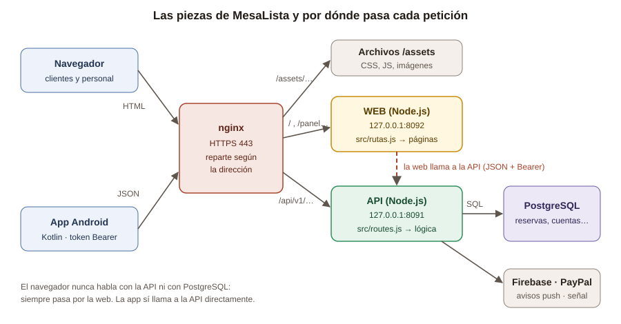
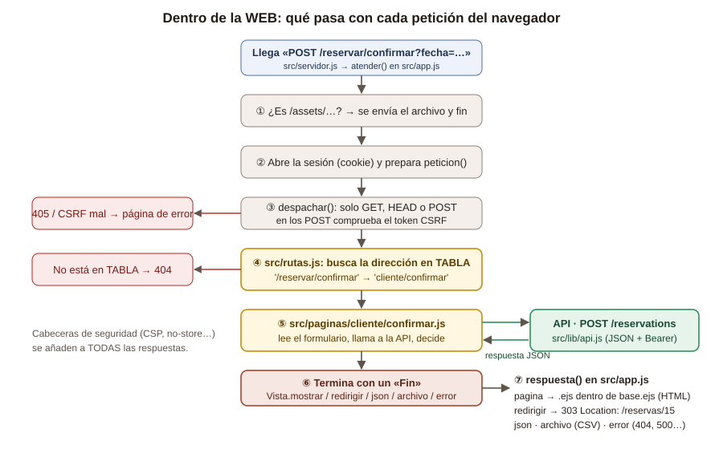
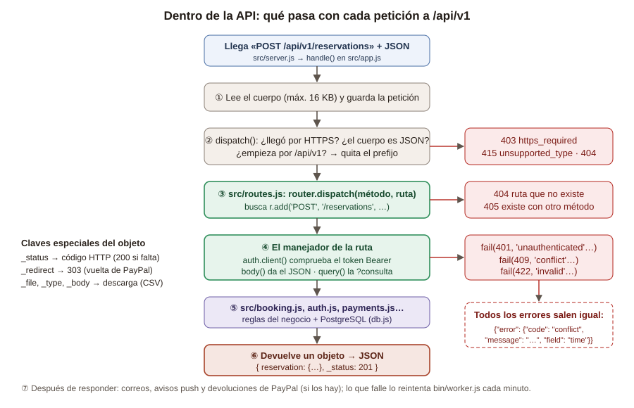
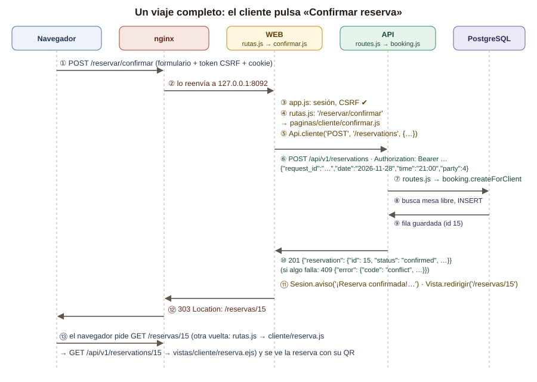

# Manual: cómo funcionan las rutas de la WEB y del Servidor (API REST)

Este manual explica, para alguien que empieza de cero, qué hacen los dos
archivos de rutas de MesaLista y cómo viaja la información:

- **`src/rutas.js` de la WEB** ([LXAST-MesaLista/WEB](https://github.com/LXAST-MesaLista/WEB)):
  decide qué página atiende cada dirección que escribe el navegador.
- **`src/routes.js` del Servidor** ([LXAST-MesaLista/Servidor](https://github.com/LXAST-MesaLista/Servidor)):
  decide qué código de la API atiende cada petición a `/api/v1`.

Los dos hacen lo mismo con cosas distintas: **reciben una dirección y la mandan
al código que sabe responderla**. Piensa en una centralita de teléfonos: según
el número marcado, pasa la llamada a una persona u otra.

---

## 1. Las piezas



| Pieza | Qué recibe | Qué devuelve | Archivo de rutas |
|---|---|---|---|
| **nginx** | Todo lo que llega al dominio por HTTPS | Lo reparte según la dirección | `despliegue/nginx-mesalista.conf` |
| **WEB** | Peticiones del navegador: `/`, `/reservas`, `/panel`… | Páginas HTML | `src/rutas.js` |
| **API** | Peticiones de la WEB y de la app: `/api/v1/…` | Datos en JSON | `src/routes.js` |
| **PostgreSQL** | Consultas SQL de la API | Filas de la base de datos | — |

Dos ideas clave:

1. **El navegador solo habla con la WEB.** La WEB, desde el servidor, pide los
   datos a la API. El navegador nunca ve la API ni su token.
2. **La API tiene todas las reglas** (horas libres, mesas, plazos, pagos). La WEB
   y la app solo muestran lo que la API responde.

---

## 2. Lo mínimo que hay que saber de HTTP y REST

### 2.1 Una petición y su respuesta

Cada vez que el navegador abre una página o envía un formulario hace una
**petición HTTP**:

```http
POST /reservar/confirmar?fecha=2026-11-28&hora=21:00&personas=4 HTTP/1.1
Host: mesalista.spaincentral.cloudapp.azure.com
Cookie: mesalista=…                                  ← quién eres (sesión de la web)
Content-Type: application/x-www-form-urlencoded

_csrf=…&request_id=…&note=Sin+gluten&consent=1       ← lo que has escrito en el formulario
```

| Parte | Qué es | Ejemplo |
|---|---|---|
| **Método** | Qué quieres hacer | `GET` (ver), `POST` (enviar o hacer algo) |
| **Ruta** | Qué recurso | `/reservar/confirmar` |
| **Consulta** (`?…`) | Datos en la dirección | `fecha=2026-11-28` |
| **Cabeceras** | Información extra | `Cookie`, `Authorization`, `Content-Type` |
| **Cuerpo** | Datos enviados (en POST) | Los campos del formulario o un JSON |

Y la **respuesta**:

```http
HTTP/1.1 303 See Other
Location: /reservas/15                               ← «ahora ve a esta página»
```

| Código | Significa |
|---|---|
| **200** | Bien, aquí tienes |
| **201** | Creado (por ejemplo, la reserva) |
| **303** | Ve a otra dirección (después de enviar un formulario) |
| **400** / **422** | Los datos enviados no valen |
| **401** | No has iniciado sesión, o ha caducado |
| **403** | No tienes permiso |
| **404** | No existe |
| **405** | Existe, pero no con ese método |
| **409** | Choca con una regla (hora ya ocupada, plazo pasado…) |
| **500** | Error del programa |

### 2.2 REST

La API sigue el estilo **REST**: cada ruta es una «cosa» (un recurso) y el
método dice qué haces con ella.

| Petición | Significa |
|---|---|
| `GET /api/v1/reservations` | Dame mis reservas |
| `POST /api/v1/reservations` | Crea una reserva |
| `GET /api/v1/reservations/15` | Dame la reserva 15 |
| `PATCH /api/v1/reservations/15` | Cambia parte de la reserva 15 |
| `POST /api/v1/reservations/15/cancel` | Haz la acción «cancelar» sobre la 15 |
| `DELETE /api/v1/me` | Borra mi cuenta |

Los datos de la API van en **JSON**:

```json
{"reservation": {"id": 15, "status": "confirmed", "date": "2026-11-28", "time": "21:00", "party": 4}}
```

### 2.3 Dos formas de saber quién eres

| | WEB | API |
|---|---|---|
| **Cómo** | Una **cookie** que el navegador envía sola | Un **token** en la cabecera `Authorization: Bearer <token>` |
| **Dónde se guarda** | Cookie en el navegador; los datos de la sesión, en el servidor de la web | La WEB lo guarda en su sesión; la app, cifrado en el móvil |
| **Protección extra** | Token **CSRF** en cada formulario (que otra web no envíe formularios por ti) | No hace falta: el navegador nunca envía el token por su cuenta |

---

## 3. La WEB por dentro: `src/rutas.js`

### 3.1 El archivo

`src/rutas.js` es una lista: **dirección → página** que la atiende.

```js
export const RUTAS = {
  // Público y acceso de clientes
  '/': 'publico/portada',
  '/entrar': 'publico/entrar',
  // Zona del cliente
  '/reservar': 'cliente/reservar',
  '/reservar/confirmar': 'cliente/confirmar',
  '/reservas': 'cliente/reservas',
  '/reservas/{id}': 'cliente/reserva',
  '/reservas/{id}/cancelar': 'cliente/cancelar',
  // Panel del personal
  '/panel': 'panel/sala',
  '/panel/grupos/{id}/aceptar': 'panel/grupo-aceptar',
  // …
};
```

- La **clave** (`'/reservas/{id}'`) es la dirección. `{id}` es un número:
  `/reservas/15` encaja y la página recibe `p.id = 15`.
- El **valor** (`'cliente/reserva'`) es el archivo `src/paginas/cliente/reserva.js`.
- Debajo, `TABLA` convierte cada dirección en una expresión regular, un patrón
  que sirve para comparar textos. `{id}` pasa a ser «de 1 a 18 cifras».

```js
export const TABLA = Object.entries(RUTAS).map(([patron, pagina]) => [
  new RegExp(`^${ /* '/reservas/{id}' → '^/reservas/(?<id>[0-9]{1,18})$' */ }$`),
  pagina,
]);
```

### 3.2 Qué pasa con cada petición



En `src/app.js`:

1. **`atender()`**: si la dirección empieza por `/assets/`, devuelve el archivo
   (CSS, JS, imágenes) y termina. En el servidor real eso lo hace nginx antes.
2. **Sesión**: lee la cookie y abre la sesión. Prepara `peticion()`, un objeto
   con todo lo de esta petición: `metodo`, `ruta`, `get` (la consulta `?…`),
   `post` (el formulario), `ip` y `sesion`.
3. **`despachar()`**: solo admite `GET`, `HEAD` y `POST` (si no, 405). En los
   `POST` lee el formulario y **comprueba el token CSRF**.
4. **Busca la ruta**: recorre `TABLA` de arriba abajo. La primera que encaja
   gana, y carga su página (`src/paginas/…js`). Si ninguna encaja, 404.
5. **La página** hace su trabajo (apartado 3.3).
6. La página **termina con un «Fin»**: le dice a `app.js` qué responder.
7. **`respuesta()`** convierte el Fin en la respuesta HTTP y añade a todas las
   cabeceras de seguridad (CSP, `no-store`…).

| La página termina con… | Respuesta |
|---|---|
| `Vista.mostrar('cliente/reservas', datos, opciones)` | `200` + HTML: la plantilla `vistas/cliente/reservas.ejs` dentro de `vistas/base.ejs` |
| `Vista.redirigir('/reservas/15')` | `303` + `Location: /reservas/15` |
| `Vista.json(200, datos)` | JSON (para el JavaScript de la propia web, como el panel) |
| `Vista.archivo(tipo, nombre, cuerpo)` | Descarga (el CSV de la agenda) |
| `Vista.error(404, 'Título', 'Texto')` / `Vista.noEncontrada()` | Página de error |

Un «Fin» funciona como un `return` que corta en seco: en cuanto la página llama
a `Vista.redirigir(…)`, no se ejecuta nada más de ella.

### 3.3 Una página por dentro

Ejemplo real: **entrar** (`src/paginas/publico/entrar.js`), dirección `/entrar`.

```js
export default async function () {
  const { get, post, metodo } = peticion();                 // datos de esta petición
  const next = siguiente(get.next ?? null);                  // a dónde volver después
  if (Sesion.usuario('cliente') !== null) {
    Vista.redirigir(next);                                   // ya ha entrado: fuera
  }

  let email = '';
  let errores = {};
  if (metodo === 'POST') {                                   // ha enviado el formulario
    email = texto(post.email).trim();
    const r = await Api.call('cliente', 'POST', '/auth/login', { email, password: texto(post.password) });
    if (r.ok()) {
      Sesion.entrar('cliente', r.body.session, r.body.user); // guarda el token en la sesión de la web
      Vista.redirigir(next);
    }
    errores = { _: r.message() };                            // mensaje de la API, en español
  }

  // GET (primera vez) o POST con error: se dibuja el formulario.
  Vista.mostrar('publico/entrar', { email, errores, next },
    { titulo: 'Iniciar sesión', ancho: 'estrecho', activa: 'entrar' }, Object.keys(errores).length ? 400 : 200);
}
```

El patrón de casi todas las páginas:

| Paso | Código |
|---|---|
| ¿Hace falta sesión? | `Cliente.exigir()` o `Panel.exigir()`: si no hay, a «Entrar» |
| Leer lo que llega | `peticion().get` (dirección), `peticion().post` (formulario), `p.id` (de la ruta) |
| Pedir datos o hacer la acción | `Api.cliente(…)`, `Api.panel(…)` o `Api.call(…)` |
| Si ha ido bien | `Vista.redirigir(…)`, normalmente tras un `POST`, con un aviso `Sesion.aviso('success', …)` |
| Si no, o si es un GET | `Vista.mostrar('plantilla', datos)` |

**GET muestra, POST cambia.** Todo lo que cambia algo (reservar, cancelar,
guardar) llega por `POST` con token CSRF y, si sale bien, termina con una
redirección. Así, si el usuario recarga la página, no se repite la acción.

### 3.4 Cómo llama la WEB a la API: `src/lib/api.js`

| Función | Sesión que usa | Si la sesión ha caducado (401) |
|---|---|---|
| `Api.cliente(método, ruta, cuerpo)` | La del cliente | Aviso y a `/entrar` |
| `Api.panel(método, ruta, cuerpo)` | La del personal | Aviso y a `/panel/entrar` |
| `Api.call(zona, método, ruta, cuerpo)` | La que diga `zona`, si hay | Devuelve el 401 sin redirigir (para entrar, registrarse…) |
| `Api.config()` | — | `GET /config`, una vez por petición |

Cada llamada envía `Accept: application/json`, `Authorization: Bearer <token>`
(si hay sesión), `X-Forwarded-For` (la IP del navegador, para el bloqueo por
intentos fallidos) y el cuerpo en JSON. Devuelve una **`Respuesta`**:

| Método | Da |
|---|---|
| `r.ok()` | `true` si el código es 2xx |
| `r.body` | El JSON de la respuesta |
| `r.datos()` | El JSON si ha ido bien; si no, termina con una página de error |
| `r.code()`, `r.message()`, `r.field()` | El `code`, el `message` y el `field` del error |

Sin conexión con la API no lanza ninguna excepción: devuelve una `Respuesta` con
status `0` y el mensaje «No se puede conectar con el servidor de reservas».

---

## 4. La API por dentro: `src/routes.js`

### 4.1 El archivo

`src/routes.js` es una lista de `r.add(método, ruta, manejador)`:

```js
// Público
r.add('GET', '/availability', async () => ({
  times: await booking.availability(V.date(query('date')), V.int(query('party'), 'party', 1, 255)),
}));

// Cliente
r.add('POST', '/reservations', async () => {
  const [res, created] = await booking.createForClient(await auth.client(), body());
  return { reservation: present.client(res), replayed: !created, _status: created ? 201 : 200 };
});

r.add('GET', '/reservations/{id}', async (p) => {
  const u = await auth.client();
  return { reservation: present.client(await booking.getOwned(u.id, p.id)) };
});
```

- **Método y ruta**: igual que en la WEB, pero **sin** `/api/v1` (se quita antes).
  `{id}` es un número de 1 a 10 cifras sin ceros delante y llega como `p.id`.
- **Manejador**: una función `async` que **devuelve un objeto**. Ese objeto se
  convierte en el JSON de la respuesta.
- **El orden importa**: como en la WEB, gana la primera ruta que encaja.

Las 74 rutas se agrupan así:

| Grupo | Rutas | Quién |
|---|---|---|
| Públicas | `/config`, `/availability`, `/payments/return` | Cualquiera |
| Cliente | `/auth/*`, `/me*`, `/reservations*`, `/group-requests*` | Web y app (sesión de cliente) |
| Panel | `/panel/*` | Personal y administración (sesión de panel) |
| Administración | `/admin/*` | Solo administración |

### 4.2 Qué pasa con cada petición



En `src/app.js` (el de la API):

1. **`handle()`**: lee el cuerpo (como mucho 16 KB) y guarda los datos de la
   petición para que cualquier función pueda leerlos.
2. **`dispatch()`**:
   - Rechaza lo que no llega por HTTPS (403 `https_required`). nginx avisa con
     `X-Forwarded-Proto: https`.
   - Si hay cuerpo, tiene que ser JSON (415 `unsupported_type`).
   - La ruta tiene que empezar por `/api/v1` (404). Le quita ese prefijo.
3. **`router.dispatch(método, ruta)`** (`src/http.js`) recorre las rutas de
   `routes.js`:
   - Encaja la ruta y el método: ejecuta el manejador.
   - Encaja la ruta pero no el método: 405 `method_not_allowed`.
   - No encaja nada: 404 `not_found`.
4. **El manejador**:
   - Comprueba quién llama: `auth.client()` (cliente), `auth.staff()`
     (personal o administración) o `auth.admin()` (solo administración). Si el
     token falta, ha caducado o es de otro tipo, se corta con 401 o 403.
   - Lee los datos: `body()` (el JSON del cuerpo), `query('date')` (la consulta) o `p.id` (la ruta).
   - Llama al módulo que tiene la lógica: `booking.js` (reservas y mesas),
     `auth.js` (cuentas), `group-requests.js`, `payments.js`, `push.js`, `admin.js`…
5. **Los módulos** aplican las reglas y hablan con PostgreSQL (`db.js`).
6. **El objeto devuelto** se envía como JSON. Claves especiales:

| Clave | Efecto |
|---|---|
| `_status: 201` | Código HTTP (200 si no se pone) |
| `_redirect: 'https://…'` | Redirección 303 (la vuelta de PayPal) |
| `_file`, `_type`, `_body` | Descarga de un archivo (el CSV de la agenda) |

7. **Después de responder**, si la petición dejó correos, avisos push o
   devoluciones pendientes, se envían. Lo que falle lo reintenta `bin/worker.js`
   cada minuto.

### 4.3 Los errores

En cualquier punto, el código puede cortar con:

```js
fail(409, 'conflict', 'Esa hora ya no está disponible. Elige otra.', { field: 'time' });
```

y la respuesta sale **siempre** con la misma forma:

```json
{"error": {"code": "conflict", "message": "Esa hora ya no está disponible. Elige otra.", "field": "time"}}
```

- `code`: para que el programa decida qué hacer (la WEB y la app miran esto).
- `message`: para mostrárselo a la persona, ya en español.
- `field`: el campo del formulario que está mal (si lo hay).

Un error inesperado (un fallo del programa) responde `500 server_error`, y en
el registro del servidor solo queda el archivo y la línea, nunca los datos de
la persona.

---

## 5. Un viaje completo: reservar una mesa



1. El cliente está en `/reservar/confirmar?fecha=2026-11-28&hora=21:00&personas=4`
   y pulsa **Confirmar reserva**. El navegador envía un `POST` con el formulario
   (menú, nota, `request_id`, token CSRF) y su cookie.
2. **nginx** ve que no es `/assets` ni `/api/v1` y lo pasa a la WEB (`127.0.0.1:8092`).
3. **WEB, `app.js`**: abre la sesión y comprueba el token CSRF.
4. **WEB, `rutas.js`**: `'/reservar/confirmar'` → `paginas/cliente/confirmar.js`.
5. **`confirmar.js`** llama a la API con la sesión del cliente:

   ```js
   const r = await Api.cliente('POST', '/reservations', {
     request_id: requestId, date: fecha, time: hora, party: personas, ...Cliente.extrasApi(extras),
   });
   ```

6. **`api.js`** envía la petición a la API:

   ```http
   POST /api/v1/reservations
   Authorization: Bearer 9f2c…
   Content-Type: application/json

   {"request_id": "3f1c…", "date": "2026-11-28", "time": "21:00", "party": 4, "menu_options": [2], "note": "Sin gluten", "consent": true}
   ```

7. **API, `app.js` → `routes.js`**: `POST /reservations` → `auth.client()`
   comprueba el token → `booking.createForClient(usuario, body())`.
8. **`booking.js`** comprueba las reglas (día abierto, antelación, comensales) y,
   en una transacción de PostgreSQL, bloquea las mesas candidatas, elige una
   libre y guarda la reserva.
9. PostgreSQL confirma la fila (id 15).
10. **La API responde**:

    ```json
    {"reservation": {"id": 15, "status": "confirmed", "date": "2026-11-28", "time": "21:00", "party": 4, "qr": "ML1.15.1.…"}, "replayed": false}
    ```

    con código `201`. Después avisa por push al móvil del cliente.
11. **`confirmar.js`**: `r.ok()` es verdadero, así que deja un aviso verde y redirige:

    ```js
    Sesion.aviso('success', '¡Reserva confirmada! Tienes el QR en «Mis reservas».');
    Vista.redirigir(`/reservas/${Number(r.body.reservation.id)}`);
    ```

12. La WEB responde `303 Location: /reservas/15`.
13. El navegador pide `GET /reservas/15` y empieza otro viaje igual:
    `rutas.js` → `cliente/reserva.js` → `GET /api/v1/reservations/15` →
    `vistas/cliente/reserva.ejs`. Se ve la reserva con su QR.

**¿Y si otra persona se adelanta?** En el paso 10 la API responde
`409 {"error": {"code": "conflict", …}}`. En el paso 11, `confirmar.js` lo ve
(`r.code() === 'conflict'`), deja el mensaje en amarillo y redirige a
`/reservar` para elegir otra hora.

**¿Y si el usuario pulsa dos veces?** Las dos peticiones llevan el mismo
`request_id`. La segunda recibe la misma reserva con `"replayed": true` y no
se crea otra.

---

## 6. Tabla completa: dirección de la WEB → llamadas a la API

«—» quiere decir que la página no llama a la API. `{id}` es el número que va
en la dirección.

### Público y acceso

| WEB | Página | API |
|---|---|---|
| `/` | `publico/portada` | `GET /config`; con sesión, también `GET /me/notifications` y `GET /reservations` |
| `/entrar` | `publico/entrar` | `POST /auth/login` |
| `/registro` | `publico/registro` | `POST /auth/register` |
| `/salir` | `publico/salir` | `POST /auth/logout` |
| `/recuperar` | `publico/recuperar` | `POST /auth/forgot` |
| `/restablecer` | `publico/restablecer` | `POST /auth/reset` |

### Cliente

| WEB | Página | API |
|---|---|---|
| `/reservar` | `cliente/reservar` | `GET /config`, `GET /availability?date=&party=` |
| `/reservar/confirmar` | `cliente/confirmar` | `GET /config`, `POST /reservations` |
| `/reservas` | `cliente/reservas` | `GET /reservations`, `GET /group-requests` |
| `/reservas/{id}` | `cliente/reserva` | `GET /reservations/{id}` |
| `/reservas/{id}/modificar` | `cliente/modificar` | `GET /reservations/{id}`, `PATCH /reservations/{id}` |
| `/reservas/{id}/cancelar` | `cliente/cancelar` | `POST /reservations/{id}/cancel` |
| `/reservas/{id}/pagar` | `cliente/pagar` | `POST /reservations/{id}/pay` → redirige a PayPal |
| `/vincular` | `cliente/vincular` | `POST /reservations/link` |
| `/grupos` | `cliente/grupos` | `GET /group-requests/times`, `POST /group-requests` |
| `/grupos/{id}/cancelar` | `cliente/grupo-cancelar` | `POST /group-requests/{id}/cancel` |
| `/cuenta` | `cliente/cuenta` | `PATCH /me` |
| `/cuenta/eliminar` | `cliente/cuenta-eliminar` | `DELETE /me` |
| `/avisos/leidos` | `cliente/avisos-leidos` | `POST /me/notifications/read` |

### Panel del personal

| WEB | Página | API |
|---|---|---|
| `/panel/entrar` | `panel/entrar` | `POST /panel/login` |
| `/panel/salir` | `panel/salir` | `POST /panel/logout` |
| `/panel` (sala) | `panel/sala` | `GET /panel/room` |
| `/panel/agenda` | `panel/agenda` | `GET /panel/reservations?date=&q=`, `GET /panel/holds?date=` |
| `/panel/agenda.csv` | `panel/agenda-csv` | `GET /panel/reservations.csv?date=` |
| `/panel/reservas/{id}/llegada` | `panel/llegada` | `POST /panel/reservations/{id}/arrive` |
| `/panel/reservas/{id}/terminar` | `panel/terminar` | `POST /panel/reservations/{id}/complete` |
| `/panel/reservas/{id}/comensales` | `panel/comensales` | `POST /panel/reservations/{id}/party` |
| `/panel/reservas/{id}/cancelar` | `panel/cancelar` | `POST /panel/reservations/{id}/cancel` |
| `/panel/reservas/{id}/mesas` | `panel/mesas` | `GET /panel/reservations/{id}/free-tables`, `GET /panel/room`, `POST /panel/reservations/{id}/move\|join\|separate` |
| `/panel/reservas/{id}/ticket` | `panel/ticket` | `GET /panel/reservations/{id}/ticket` |
| `/panel/escanear` | `panel/escanear` | `POST /panel/arrive-qr` |
| `/panel/nueva` | `panel/nueva` | `POST /panel/reservations` |
| `/panel/sin-reserva` | `panel/sin-reserva` | `POST /panel/walkin` |
| `/panel/grupos` | `panel/grupos` | `GET /panel/group-requests` |
| `/panel/grupos/{id}/aceptar` | `panel/grupo-aceptar` | `GET /panel/group-requests`, `GET /panel/group-requests/{id}/tables`, `POST /panel/group-requests/{id}/accept` |
| `/panel/grupos/{id}/rechazar` | `panel/grupo-rechazar` | `POST /panel/group-requests/{id}/reject` |
| `/panel/bloqueos` | `panel/bloqueos` | `GET /panel/holds`, `GET /panel/room`, `POST /panel/holds` |
| `/panel/bloqueos/{id}/quitar` | `panel/bloqueo-quitar` | `DELETE /panel/holds/{id}` |
| `/panel/cerrar-local` | `panel/cerrar-local` | `POST /panel/close` |
| `/ajax/panel/version` | `panel/ajax-version` | `GET /panel/version` (cada segundo, para recargar la sala) |

### Administración

| WEB | Página | API |
|---|---|---|
| `/panel/admin/mesas` | `admin/mesas` | `GET /admin/tables`, `POST /admin/tables` |
| `/panel/admin/mesas/{id}` | `admin/mesa` | `PATCH /admin/tables/{id}` |
| `/panel/admin/mesas/{id}/eliminar` | `admin/mesa-eliminar` | `DELETE /admin/tables/{id}` |
| `/panel/admin/plano` | `admin/plano` | `PUT /admin/tables/layout` |
| `/panel/admin/clientes` | `admin/clientes` | `GET /admin/clients?q=` |
| `/panel/admin/estadisticas` | `admin/estadisticas` | `GET /config`, `GET /admin/stats?from=&to=` |
| `/panel/admin/horario` | `admin/horario` | `GET /admin/schedule`, `PUT /admin/schedule/slots` |
| `/panel/admin/horario/cerrar` | `admin/dia-cerrar` | `POST /admin/schedule/closed` |
| `/panel/admin/horario/abrir` | `admin/dia-abrir` | `POST /admin/schedule/open` |
| `/panel/admin/parametros` | `admin/parametros` | `GET /admin/settings`, `PUT /admin/settings` |
| `/panel/admin/pin` | `admin/pin` | `PUT /admin/close-pin` |
| `/panel/admin/menu` | `admin/menu-nueva` | `POST /admin/menu-options` |
| `/panel/admin/menu/{id}` | `admin/menu-opcion` | `PATCH /admin/menu-options/{id}` |
| `/panel/admin/personal` | `admin/personal` | `GET /admin/staff`, `POST /admin/staff` |
| `/panel/admin/personal/{id}` | `admin/personal-cuenta` | `PATCH /admin/staff/{id}` |

La app Android no pasa por la WEB: llama directamente a las rutas de cliente de
la API (ver `docs/manual-desarrollo.md` del repositorio APP).

---

## 7. Añadir una ruta nueva, paso a paso

Ejemplo: una página «Mi resumen», en `/cuenta/resumen`, que muestre cuántas
reservas tiene el cliente. Hace falta una ruta en la API y una en la WEB.

### 7.1 En el Servidor (la API)

En `src/routes.js`, junto a las demás de cliente:

```js
// Resumen del cliente: cuántas reservas tiene en cada estado.
r.add('GET', '/me/summary', async () => {
  const u = await auth.client();                               // 1. solo clientes con sesión
  const filas = await db.all(                                  // 2. la consulta (con ? para los datos)
    'SELECT status, COUNT(*)::int AS n FROM reservations WHERE user_id = ? GROUP BY status',
    [u.id],
  );
  return { summary: Object.fromEntries(filas.map((f) => [f.status, f.n])) };   // 3. el JSON
});
```

- La comprobación de sesión va **siempre** en el manejador (`auth.client()`,
  `auth.staff()` o `auth.admin()`). Si se olvida, cualquiera podría llamar a la ruta.
- Los datos que vienen de fuera se validan con `V.…` (`V.int`, `V.date`,
  `V.text`) y nunca se pegan dentro del SQL: van en la lista de `?`.
- Documéntala en `docs/openapi.yaml`.
- Pruébala:

  ```bash
  curl https://<dominio>/api/v1/me/summary -H "Authorization: Bearer <token>"
  ```

  Respuesta: `{"summary": {"confirmed": 2, "completed": 5}}`.

### 7.2 En la WEB

**1.** `src/rutas.js`, en «Zona del cliente»: `'/cuenta/resumen': 'cliente/resumen',`

**2.** `src/paginas/cliente/resumen.js`:

```js
import { Vista } from '../../lib/vista.js';
import { Api } from '../../lib/api.js';
import { Cliente } from '../../lib/zonas.js';

export default async function () {
  Cliente.exigir();                                            // sin sesión → /entrar
  const { summary } = (await Api.cliente('GET', '/me/summary')).datos();
  Vista.mostrar('cliente/resumen', { summary }, { titulo: 'Mi resumen', activa: 'cuenta', ancho: 'estrecho' });
}
```

**3.** `vistas/cliente/resumen.ejs`:

```html
<h1 class="h3 mb-3">Mi resumen</h1>
<ul class="list-group">
<% for (const [estado, n] of Object.entries(summary)) { -%>
  <li class="list-group-item d-flex justify-content-between">
    <%- Formato.estado(estado) %> <strong><%= n %></strong>
  </li>
<% } -%>
</ul>
```

**4.** Un enlace en el menú (`vistas/menu-cliente.ejs`) o en `vistas/cliente/cuenta.ejs`.

**5.** Prueba: `npm start` y abre `http://127.0.0.1:8092/cuenta/resumen`.

Si la página **cambia** algo (no solo lo muestra), el formulario es `method="post"`,
lleva `<%- Csrf.campo() %>` y la página termina con `Vista.redirigir(…)`.

---

## 8. Probar y encontrar errores

| Qué ves | Dónde está el fallo | Qué mirar |
|---|---|---|
| «Página no encontrada» en la WEB | La dirección no está en `src/rutas.js` | La clave de `RUTAS` y la `{id}` |
| «Método no permitido» en la WEB | Petición que no es GET, HEAD ni POST | El `method` del formulario |
| La página se recarga y vuelve a «Entrar» | Sesión caducada (la API dio 401) | Normal: volver a entrar |
| Error al enviar un formulario (CSRF) | Falta `<%- Csrf.campo() %>` o la sesión cambió | La plantilla del formulario |
| «No se puede conectar con el servidor de reservas» | La WEB no llega a la API | `api` en `config.json` de la WEB, `systemctl status mesalista-api` |
| `{"error": {"code": "not_found"}}` en la API | Ruta mal escrita, o sin `/api/v1` | `curl` a la ruta; la lista de `r.add` |
| `method_not_allowed` | La ruta existe con otro método | GET o POST según `r.add` |
| `unsupported_type` | El cuerpo no se envió como JSON | Cabecera `Content-Type: application/json` |
| `https_required` | Petición directa a la API por HTTP | Usar `https://<dominio>/api/v1` |
| `server_error` | Fallo del programa | `sudo mesalista logs` (archivo y línea) |

Registros:

- API: `sudo mesalista logs` (o `journalctl -u mesalista-api`).
- WEB: `journalctl -u mesalista-web`.
- nginx: `/var/log/nginx/mesalista-error.log` y `mesalista-access.log` (cada
  petición con su código, sin la consulta).

---

## 9. Glosario

| Término | Qué es |
|---|---|
| **Ruta** | La dirección de algo: `/reservas/15`, `/api/v1/reservations` |
| **Archivo de rutas** | Lista que dice qué código atiende cada ruta (`rutas.js`, `routes.js`) |
| **Manejador** | La función que atiende una ruta de la API |
| **Página** | Archivo de `src/paginas/` que atiende una ruta de la WEB |
| **Plantilla (EJS)** | HTML con huecos para los datos (`vistas/…ejs`) |
| **Fin** | Cómo termina una página de la WEB: mostrar, redirigir, JSON, archivo o error |
| **HTTP** | El idioma en que hablan navegador, WEB y API |
| **Método** | GET, POST, PATCH, PUT, DELETE: qué quieres hacer |
| **Código de estado** | Número de la respuesta: 200, 303, 404, 409… |
| **REST** | Estilo de API: rutas como recursos y métodos como acciones |
| **JSON** | Formato de datos: `{"clave": "valor"}` |
| **API** | El servidor que da los datos en JSON (`/api/v1`) |
| **nginx** | El servidor que recibe el HTTPS y reparte entre la WEB y la API |
| **Cookie** | Dato que el navegador guarda y envía solo en cada petición a la web |
| **Sesión** | Lo que la web o la API recuerdan de ti entre peticiones |
| **Token Bearer** | Llave temporal para la API, en `Authorization: Bearer …` |
| **CSRF** | Ataque en el que otra web envía un formulario en tu nombre; se evita con un token oculto |
| **Expresión regular** | Patrón para comparar textos (así se compara cada ruta) |
| **Redirección (303)** | Respuesta que dice al navegador que vaya a otra dirección |
| **Transacción** | Grupo de cambios en la base de datos que se hacen todos o ninguno |
